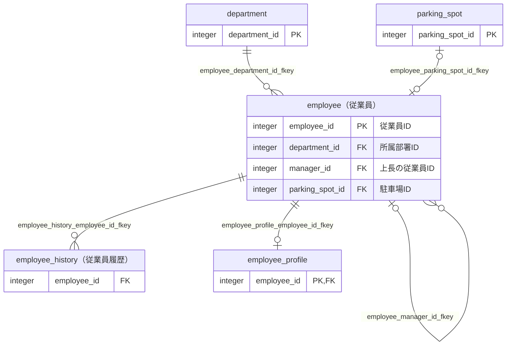

## はじめに

以前、[【PostgreSQL】Markdown形式のテーブル定義書を自動生成するツールを作ってみた](https://qiita.com/ebichan_88/items/bc1ad07b6a7fd1479290)という記事で、`exportTableDefinition`というツールを紹介しました。

DBに接続して、テーブル一覧とテーブル定義書をMarkdown形式で出力するツールです。

その後、このツールに少しずつ機能を足していった結果、テーブル定義書だけでなく、ER図やAI向けのMCPサーバーまで出せるようになりました。
名前も`exportTableDefinition`から**dbxray**に改めています。

本記事は、そのdbxrayを前作の続編として紹介する記事です。

ただ、機能がかなり増えてしまったので、全部はとても紹介しきれません・・。
本記事では前作からの変化と主な機能に絞り、細かい仕様はリポジトリのドキュメントに任せることにします。

:::note info
機能強化の大部分は、Claude Codeと対話しながら進めました[^1]。
:::

## 作成したツール

### リポジトリ

GitHubのリポジトリは[こちら（dbxray）](https://github.com/ebichan88/dbxray)です。

本記事の内容は、執筆時点の最新版である`v0.4.2`に基づいています。

### 前作からの主な変化

前作と比べると、主に以下が変わっています。

| 項目 | 前作（exportTableDefinition） | dbxray |
|:---|:---|:---|
| 出力するもの | テーブル一覧・テーブル定義書 | 左記に加えて、ER図・README（索引と集計）・関数／シーケンス／ユーザー定義型／トリガーの一覧・スナップショット（JSON Lines） |
| DBに無い情報の補足 | テーブル説明の枠を用意 | サイドカーYAMLで、説明・備考・論理リレーション・観点を宣言できる |
| 差分の検知 | なし | `--check`で、DBとコミット済みのドキュメントの差分を検知できる |
| 設定ファイル | propertiesファイル | `conf/config.yml`（全項目をCLI引数で上書きできる） |
| Oracle | デフォルト値などの一部の項目は出力不可 | PostgreSQLと同じ種別のオブジェクトを出力 |
| 配布形式 | 実行可能形式のJarファイル | Java実行環境を同梱したzip（Windows・Linux・macOS） |
| AIからの利用 | なし | MCPサーバーを同梱 |

### 使い方

[Releases](https://github.com/ebichan88/dbxray/releases/latest)からOSに合ったzipをダウンロードし、好きな場所に展開して使います。

Java実行環境を同梱しているので、Javaをインストールしていない環境でも実行できます。

1. `conf/config.yml`の`database`に、接続先のDBの情報を書く
2. パスワードを環境変数`DBXRAY_DB_PASSWORD`で渡す
3. `run.bat`（Linux／macOSの場合は`run.sh`）を実行する

```yaml:conf/config.yml（記載例）
database:
  driver: org.postgresql.Driver
  url: jdbc:postgresql://localhost:5432/testdb
  username: app
target:
  schemas: [sample]
  tables: ["!flyway_schema_history"]
output:
  path: ./docs/db
annotations: ./conf/annotations.yml
```

処理が終わると、`output.path`配下にMarkdown形式のドキュメントが出力されます。

パスワードは設定ファイルには書けないようにしています[^2]。

### 対象DBMS

| DBMS | 推奨バージョン |
|:---|:---|
| PostgreSQL | 13以上 |
| Oracle | 12c以上 |

### 利用技術／ライブラリ等

* Java 21
* MyBatis
* SnakeYAML・Jackson
* MCP Java SDK（MCPサーバー）
* PostgreSQL・Oracle　など

## 出力されるもの

ここからは、リポジトリに置いているサンプルのDBから出力した結果を使って紹介します。

### ER図

外部キーの関係を、Mermaid記法のER図として出力します。

GitHubやQiitaであれば、Markdownのままで図として表示できます。



箱にはテーブルの論理名と、関連をつなぐカラムを表示しています。
多重度（1対多、0..1対1 など）は、一意制約や一意インデックスの有無から判定しています。

テーブルが多いとER図が読めなくなるため、描画するテーブル数に上限を設け、超える場合は関連のまとまりごとに分割して出力します。

### テーブル定義書

前作と同じく、カラム・インデックス・制約・外部キー情報などをテーブルごとのMarkdownに出力します。

以下は、`employee`テーブルのカラム情報の先頭6行です。

| No. | 論理名 | 物理名 | データ型 | 桁数/精度 | PK | Not Null | デフォルト | 備考 |
|:---|:---|:---|:---|:---|:---|:---|:---|:---|
|1|従業員ID|employee_id|integer||○|○|nextval('sample.employee_employee_id_seq'::regclass)||
|2|従業員コード|employee_code|character varying(10)|10||○|||
|3|従業員名|employee_name|character varying(50)|50||○|||
|4|所属部署ID|department_id|integer|||○|||
|5|上長の従業員ID|manager_id|integer||||||
|6|駐車場ID|parking_spot_id|integer||||||

前作から、どのテーブルから参照されているかを示す「被参照情報」や、トリガー情報も追加しています。

### そのほかの出力

テーブル定義書とER図のほかに、以下も出力します。

* README：生成した全ドキュメントへのリンクと、スキーマごとのオブジェクトの数・論理名の記述状況などの集計
* 関数・プロシージャ、シーケンス、ユーザー定義型の一覧と個別ページ
* スキーマのスナップショット：同じ情報をJSON Lines形式で構造化したもの

READMEの集計では、論理名（DBのコメント）がどれだけ書かれているかを「論理名あり／全体」の件数で出しています。
初めて触るDBで、論理名をどこまで当てにできるかの目安になればと思っています。

スナップショットは、後述する`--check`とMCPサーバーの入力として使います。

## DBに無い情報を補う（サイドカーYAML）

テーブル定義書は実行のたびに全部上書きされるため、出力されたMarkdownを手で編集しても、次の実行で消えてしまいます。

そこで、DBから取得できない情報は、サイドカーYAMLという別のファイルに書いておき、出力のたびにマージする形にしました。

サイドカーYAMLには、次の3種類の情報を書けます。

| セクション | 内容 |
|:---|:---|
| `tables` | テーブルの説明・備考、カラムの備考 |
| `relations` | 論理リレーション（DBに外部キー制約が無いテーブル間の関連） |
| `viewpoints` | 観点（「受注管理」のような業務単位のテーブルのまとまり） |

個人的に一番使いどころがありそうだと思っているのは、`relations`です。

アプリケーション側で参照整合性を担保していて、DBに外部キー制約を張っていないシステムだと、システムカタログから読み取れる関連が無いので、ER図がほとんど空になってしまいます。
`relations`に関連を宣言しておくと、ER図に破線で描かれるようになります。

```yaml:annotations.yml（論理リレーションの記載例）
relations:
  - table: public.logs           # 参照元（子）。スキーマ名.物理テーブル名
    columns: [user_id]           # 参照元のカラム
    parentTable: public.users    # 参照先（親）
    parentColumns: [id]          # 参照先のカラム
    cardinality: 0..1対多         # 多重度（省略可）
```

DBに制約がある関連（実線）と、人が宣言した関連（破線）を、ER図の上で見分けられるようにしています。

## DBとドキュメントのずれを検知する（--checkモード）

テーブル定義書を出力してGitにコミットしても、マイグレーションのたびに出力し直すのを忘れると、ドキュメントとDBがずれていきます。

`--check`を付けて実行すると、DBの現状と、コミット済みのスナップショットを比べて、差分があれば終了コードで知らせてくれます。

```bash:実行コマンド
java -jar dbxray.jar --check
```

変更があったオブジェクトは、以下のようにunified diff形式で表示します。

```text:実行結果（一部抜粋）
Content differs:
 - table sample.employee

--- committed/testdb/sample/tables.jsonl (table sample.employee)
+++ generated/testdb/sample/tables.jsonl (table sample.employee)
@@ -8,6 +8,7 @@
   "columns": [
     {"name":"employee_id","type":"integer","primaryKey":true,"notNull":true}
     {"name":"name","type":"character varying(100)","primaryKey":false,"notNull":true}
+    {"name":"nickname","type":"text","primaryKey":false,"notNull":false}
   ]
```

CIに組み込んでおけば、ドキュメントの更新漏れを機械的に検知できます。

## AIからテーブル定義を調べる（MCPサーバー）

前作から一番大きく変わったのが、このMCPサーバーかと思います。

出力したスナップショットを、Claude CodeなどのAIからMCP（Model Context Protocol）のツールで検索できるようにするサーバーです。
配布するzipに同梱しています。

テーブル定義書のリポジトリとは別のリポジトリでコードを書くときに、AIが正しいテーブル名やカラム、JOINの条件を調べられるようにすることを目的にしています。

:::note warn
MCPサーバーはDBに接続しません。
出力済みのスナップショットのファイルを読むだけなので、AIの実行環境にDBの接続情報を置く必要はありません。
その代わり、DBを変更した場合は、dbxrayで出力し直したスナップショットを読み込み直す必要があります。
:::

Claude Codeの場合は、以下のコマンドで登録できます。

```bash:Claude Codeへの登録（Linux／macOSの例）
claude mcp add dbxray -- /opt/dbxray-linux/runtime/bin/java -jar /opt/dbxray-linux/mcp/dbxray-mcp.jar --snapshot=/work/schema-docs/output/snapshot
```

ツールは執筆時点で19個あり、テーブルの検索、カラム名からの逆引き、2つのテーブルをつなぐJOINの経路の探索、テーブルを変更したときの影響範囲の調査などができます。

実際にClaude Codeから使ってみたときの様子です。

**物理名に`id`を含むカラムを調べてもらったとき（`find_columns`ツール）**


**従業員テーブルの周辺のER図を描いてもらったとき（`get_er_diagram`ツール）**


**employeeと構造が似たテーブルを探してもらったとき（`find_similar_tables`ツール）**


サイドカーYAMLで宣言した論理リレーションや観点も、MCPサーバーから引けるようにしています。
DBのコメントだけでなく、人が補った情報までAIに渡せるのは、テーブル定義書と同じ出力から作っているからこそかなと思います。

ツールごとの引数や結果の詳細は、[MCPサーバーのドキュメント](https://github.com/ebichan88/dbxray/blob/main/docs/usage/mcp-server.md)をご覧ください。

## おわりに

前作を書いた時点では、テーブル一覧とテーブル定義書を出力するだけのツールでしたが、気づけばER図やMCPサーバーまで出せるようになっていました。

正直、ここまで大きくなるとは思っていませんでした・・。

前作の記事の動機だった、テーブル定義書が存在しないシステムを読み解く場面で、少しでも参考になれば幸いです。

[^1]: Claude Codeを使った個人開発については、[Claude Codeで個人開発を1ヶ月やって、たどり着いた開発プロセスの話](https://qiita.com/ebichan_88/items/eead0724e9b5eb0d0120)でも書いています。ただし、こちらの記事は別のリポジトリでの話です。
[^2]: 設定ファイルに`database.password`を書いた場合や、接続URLにパスワードを埋め込んだ場合はエラーになります。パスワードはCLI引数`--db-password`でも渡せますが、プロセスの一覧やシェルの履歴に残ることがあるため、環境変数で渡すのがおすすめです。
