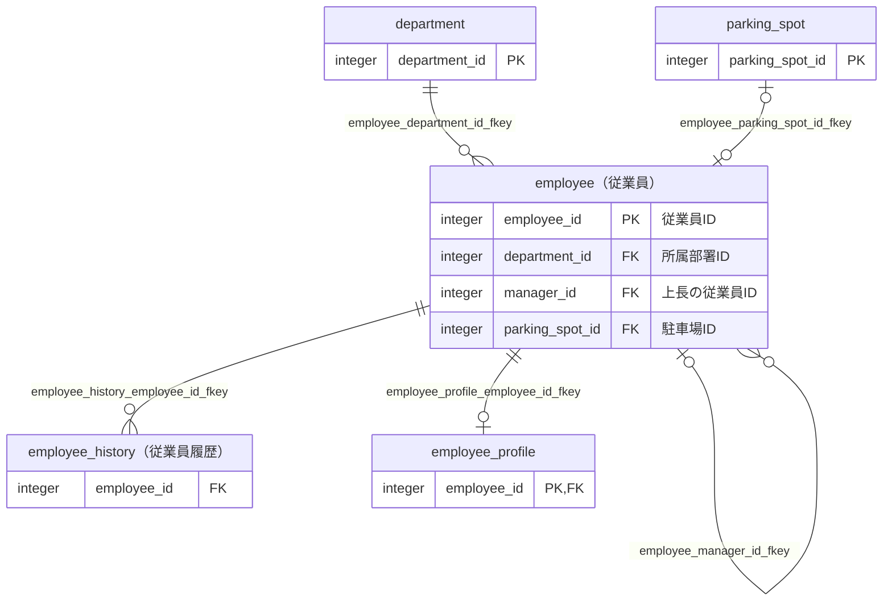
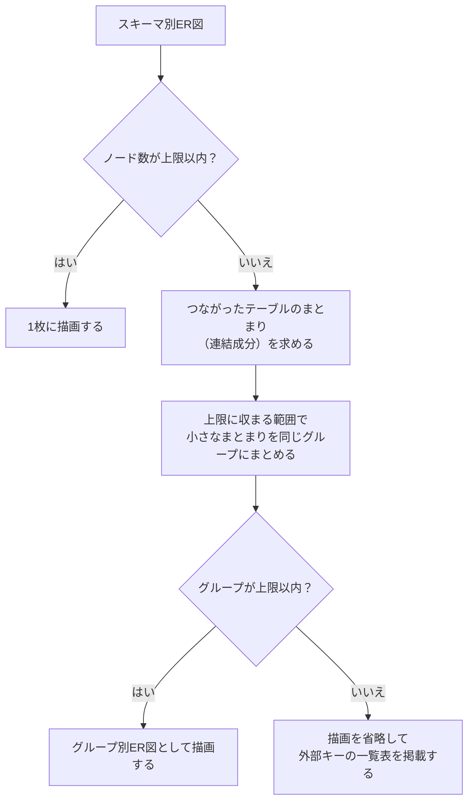
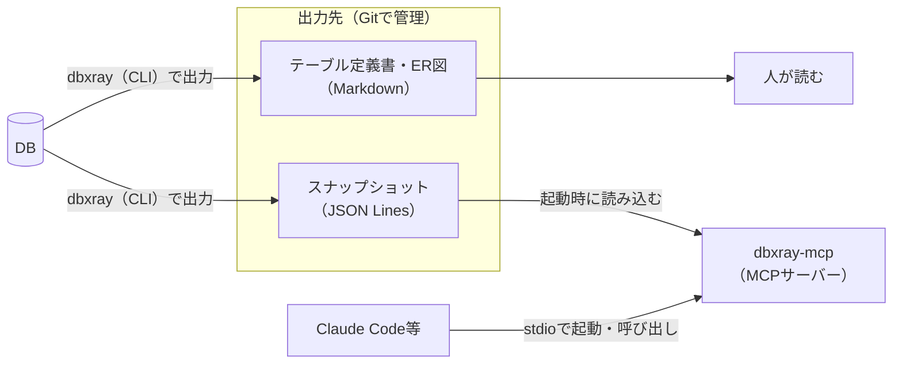

## はじめに

以前、[【PostgreSQL】Markdown形式のテーブル定義書を自動生成するツールを作ってみた](https://qiita.com/ebichan_88/items/bc1ad07b6a7fd1479290)という記事で、テーブル定義書を自動生成するツール（exportTableDefinition）を紹介しました。

先日、業務で自分があまり詳しくないサブシステムのテーブル構造を理解する必要がありました。
そこで、元々後から改善しようと思っていたSQLの修正や、ER図の出力に対応しようと思い、このツールに手を入れることにしました。

そのあと作りながら、ほしい機能が増えていき・・。
気づけば、出力したデータをAIから検索できるMCPサーバーまで付いていました。
名前もexportTableDefinitionからdbxrayに変えています[^1]。

[^1]: exportTableDefinitionはテーブル定義書に特化した名前だったので、もう少し汎用的な名前にしたいと思っていました。最初はGitLensをイメージして「dblens」にしようと思ったのですが、すでに同じ名前のリポジトリが存在しているようだったので、かぶってなさそうな名前にしました。

本記事は、dbxrayの紹介に加えて、自分が実際に使ってみたいと思って作った**ER図の出力**と**MCPサーバー**の仕組みを紹介する記事です。

なお、今回の改修のほとんどはClaude Codeに実装してもらっています。
開発の進め方については、後半で軽く触れます。

## 想定読者

- 巨大なシステムで、テーブル定義書などのドキュメントが整備されていない環境で開発している方
- AI（Claude Code等）にコードを書かせるときに、テーブルの構造もAIに調べてもらいたい方

## 前提

:::note info
- dbxray v0.4.2（2026年10月時点の最新版）
- 対応DBMS: PostgreSQL 13以上、Oracle 12c以上
- Java 21（配布用のzipにJava実行環境を同梱しているため、使うだけならJavaのインストールは不要です）
:::

GitHubのリポジトリは[こちら（dbxray）](https://github.com/ebichan88/dbxray)です。

全機能は書ききれないので、本記事では概要と、ER図・MCPサーバーの仕組みに絞って紹介します。
細かい設定や出力の仕様は、[CLIリファレンス](https://github.com/ebichan88/dbxray/blob/main/docs/usage/cli.md)と[MCPサーバーのドキュメント](https://github.com/ebichan88/dbxray/blob/main/docs/usage/mcp-server.md)をご覧ください。

:::note warn
作り込んでからは、実務ではまだ全然使えていません（これから個人的に試していこうと思っています）。
本記事の出力例・実行例は、リポジトリに同梱しているサンプルのDB（PostgreSQL）から出力したものです。
:::

## 目次 <!-- omit in toc -->

- [dbxrayとは](#dbxrayとは)
  - [概要](#概要)
  - [前回の記事から変わったこと](#前回の記事から変わったこと)
- [使い方](#使い方)
  - [入手と実行](#入手と実行)
  - [DBに無い情報を書き足す（サイドカーYAML）](#dbに無い情報を書き足すサイドカーyaml)
  - [ドキュメントの更新漏れを検知する](#ドキュメントの更新漏れを検知する)
- [ER図の出力について](#er図の出力について)
  - [出力例](#出力例)
  - [出力されるER図の種類](#出力されるer図の種類)
  - [大きなスキーマのER図を分割する](#大きなスキーマのer図を分割する)
  - [多重度の判定](#多重度の判定)
- [MCPサーバーでAIにテーブル構造を答えさせる](#mcpサーバーでaiにテーブル構造を答えさせる)
  - [MCPサーバーを作った経緯](#mcpサーバーを作った経緯)
  - [全体像](#全体像)
  - [設定方法](#設定方法)
  - [使えるツール](#使えるツール)
  - [実際に聞いてみた](#実際に聞いてみた)
  - [構造の似たテーブルを探す仕組み](#構造の似たテーブルを探す仕組み)
  - [AIに使ってもらうための設計](#aiに使ってもらうための設計)
  - [stdioで動かすときの注意点](#stdioで動かすときの注意点)
- [開発の進め方について](#開発の進め方について)
  - [Claude Codeでの進め方](#claude-codeでの進め方)
  - [苦労したこと](#苦労したこと)
- [おわりに](#おわりに)
- [参考サイト](#参考サイト)

## dbxrayとは

### 概要

dbxrayは、DBに接続して、テーブル一覧・テーブル定義書・ER図などをMarkdown形式で出力するツールです。
あわせて、出力したデータをAIから検索できるようにするMCPサーバーも同梱しています。

出力されるものは以下のとおりです。

| 出力物 | 内容 |
|:---|:---|
| テーブル一覧 | 対象のテーブルの一覧と、各テーブル定義書へのリンク |
| テーブル定義書 | カラム・インデックス・制約・外部キー・被参照・トリガーの情報など |
| ER図 | 外部キーの関係を表すMermaid記法の図（テーブル単位・スキーマ単位） |
| 観点ごとのページ | 業務の単位（人事管理、受注管理など）でまとめたテーブルのER図と一覧 |
| 関数・シーケンス・ユーザー定義型の一覧と個別ページ | 関数・プロシージャの定義本体や、ENUMの値など |
| README | 出力した全ドキュメントへの索引と、スキーマごとのオブジェクトの数の集計 |
| スナップショット | 上記と同じ情報を、機械可読なJSON Lines形式にしたもの |

テーブル定義書は、前回の記事と同じく、論理名・物理名・データ型・桁数などを並べた形で出力します。
以下は、サンプルのDBの`employee`テーブルのカラム情報の先頭6行です。

| No. | 論理名 | 物理名 | データ型 | 桁数/精度 | PK | Not Null | デフォルト | 備考 |
|:---|:---|:---|:---|:---|:---|:---|:---|:---|
|1|従業員ID|employee_id|integer||○|○|nextval('sample.employee_employee_id_seq'::regclass)||
|2|従業員コード|employee_code|character varying(10)|10||○|||
|3|従業員名|employee_name|character varying(50)|50||○|||
|4|所属部署ID|department_id|integer|||○|||
|5|上長の従業員ID|manager_id|integer||||||
|6|駐車場ID|parking_spot_id|integer||||||

出力のサンプルは[こちら（サンプルのDBのREADME）](https://github.com/ebichan88/dbxray/blob/main/docs/sample/postgres/output/testdb/README.md)から辿れます。

### 前回の記事から変わったこと

前回の記事の時点（exportTableDefinition）と比べると、以下のように変わっています。

| 項目 | 前回（exportTableDefinition） | 今回（dbxray v0.4.2） |
|:---|:---|:---|
| 出力するもの | テーブル一覧・テーブル定義書 | ＋ER図・観点ごとのページ・関数等の個別ページ・README |
| Oracle | 一部制限あり（デフォルト値・ビューのソース・Check制約の定義が出力不可） | PostgreSQLと同じ種類のオブジェクトを出力 |
| DBに無い情報 | テーブル説明の枠を用意しているだけ | サイドカーYAMLで説明・備考・論理リレーション・観点を書き足せる |
| 機械可読な出力 | なし | スナップショット（JSON Lines） |
| CIでの利用 | なし | `--check`でDBとドキュメントの差分を検知 |
| 配布形式 | 実行可能形式のJarファイル | Java実行環境を同梱したzip（Windows／Linux／macOS） |
| AIからの利用 | なし | MCPサーバー |

## 使い方

### 入手と実行

[Releases](https://github.com/ebichan88/dbxray/releases/latest)から、OSに合ったzip（`dbxray-windows.zip`など）をダウンロードして展開します。

展開したら、`conf/config.yml`に接続先のDBの情報を書きます。

```yaml:conf/config.yml（抜粋）
database:
  driver: org.postgresql.Driver
  url: jdbc:postgresql://localhost:5432/testdb
  username: postgres
```

パスワードは`conf/config.yml`には書けないようにしていて、環境変数`DBXRAY_DB_PASSWORD`で渡します[^2]。

[^2]: AIエージェント等から読まれうる設定ファイルに、パスワードを残さないためです。`database.password`を書いたり、接続URLにパスワードを埋め込んだりすると、誤りとして扱います。

```bash:実行（Linux／macOS）
export DBXRAY_DB_PASSWORD='パスワード'
./run.sh
```

Windowsの場合は、コマンドプロンプトで`set DBXRAY_DB_PASSWORD=パスワード`を実行してから`run.bat`を実行します。

処理が終わると、`output`フォルダ配下に以下のような形で出力されます。

```text:出力先の構成（抜粋）
output
├─testdb                          ・・・ Markdownのドキュメント（DBごと）
│  ├─README.md
│  ├─tableList_testdb.md
│  ├─erDiagram_testdb_sample.md
│  ├─viewpoint_testdb_personnel.md
│  └─sample
│     ├─table
│     │  └─employee.md
│     └─function
└─snapshot                        ・・・ スナップショット（MCPサーバーの入力）
   └─testdb
      ├─database.json
      └─sample
         ├─tables.jsonl
         └─functions.jsonl
```

### DBに無い情報を書き足す（サイドカーYAML）

現行のDBだと、外部キー制約が張られていなかったり、コメント（論理名）が書かれていなかったりと、DBのメタ情報だけでは分からないことも多いかと思います。

そこで、DBに無い情報は**サイドカーYAML**というファイルに書いて、出力にマージできるようにしています。
書けるのは以下の3種類です。

- `tables`: テーブルの説明・備考、カラムの備考
- `relations`: 外部キー制約の無いテーブル間の関連（論理リレーション）
- `viewpoints`: 業務の単位でテーブルをまとめる観点

```yaml:annotations.sample.yml（サンプルから抜粋）
relations:
  - table: sample.audit_log            # 参照元（子）
    columns: [record_id]
    parentTable: sample.employee       # 参照先（親）
    parentColumns: [employee_id]
    cardinality: 0..1対多              # DBに制約が無いので、多重度はここで明示する

viewpoints:
  - id: personnel
    name: 人事管理
    tables:
      - sample.employee*
      - "!sample.employee_directory_view"
      - sample.department
      - sample.parking_spot
```

論理リレーションは、ER図では物理的な外部キーと区別できるように**破線**で描画します。

```text:論理リレーションの描画（スキーマ別ER図から抜粋）
sample_employee |o..o{ sample_audit_log : "record_id"
```

観点を宣言すると、観点ごとにER図と所属テーブルの一覧をまとめたページが出力されます。
スキーマ単位のER図は機械的なまとまりなので、人が読む単位でまとめたいときに使います。

### ドキュメントの更新漏れを検知する

`--check`を付けて実行すると、コミット済みのスナップショットと、DBの現状のスナップショットを比較します。
マイグレーションの後にドキュメントを出力し直し忘れていないかを、CIで検知するための機能です。

内容が違うオブジェクトは、以下のようにunified diffの形式で表示します。

```text:--checkの出力例
Content differs:
 - table sample.employee

--- committed/testdb/sample/tables.jsonl (table sample.employee)
+++ generated/testdb/sample/tables.jsonl (table sample.employee)
@@ -8,6 +8,7 @@
   "columns": [
     {"name":"employee_id","type":"integer","primaryKey":true,"notNull":true}
     {"name":"name","type":"character varying(100)","primaryKey":false,"notNull":true}
+    {"name":"nickname","type":"text","primaryKey":false,"notNull":false}
   ]
   "indexes": [
```

差分がある場合は終了コード`1`、比較そのものに失敗した場合は`2`で終了するので、CIのジョブをそのまま失敗させられます。

Markdownではなくスナップショットを比較しているのは、スナップショットには生成日を含めていないためです。
Markdownの先頭に載せている生成日のように、実行するたびに変わる値で差分にならないようにしています[^3]。

[^3]: その代わり、Markdownだけを手作業で編集した、といった差分は検知しません。

## ER図の出力について

ここからは、今回の改修のきっかけの1つでもある、ER図の出力について紹介します。

### 出力例

ER図は、GitHubなどでそのまま図として表示できるMermaid記法で出力します。
以下は、サンプルのDBの観点「人事管理」のページに出力されたER図です（QiitaもMermaidに対応しているので、そのまま貼り付けています）。



テーブルの箱には、`テーブル名（論理テーブル名）`の見出しと、図に描いた関連をつなぐカラムだけを表示しています。
全カラムを表示すると箱が大きくなりすぎるためです（テーブル定義書の中のER図だけは、自テーブルの全カラムを表示します）。

### 出力されるER図の種類

ER図は、以下の粒度で出力します。

| 出力先 | 内容 |
|:---|:---|
| 各テーブル定義書の「ER図」セクション | 自テーブルと、直接の参照先・参照元のテーブル（段数は1〜3で変更可） |
| スキーマ別ER図 | スキーマ全体のER図 |
| グループ別ER図 | スキーマが大きい場合に、つながったテーブルのまとまりごとに分割したER図 |
| 観点ごとのページ | サイドカーYAMLで宣言した観点の、所属テーブル同士のER図 |

### 大きなスキーマのER図を分割する

前回の記事では、テーブル数が多いとGitHub上でMarkdownがパースされなくなるため、テーブル一覧のファイルを分割する対応をしていました。
ER図も、大きなスキーマを1枚に描くと線が入り乱れて読みにくくなるため、分割して出力するようにしています。

具体的には、1枚に描くテーブルの数（ノード数）に上限（既定は80）を設けて、超えた場合は以下のように出し分けています。
なお、ノード数として数えるのは、外部キーまたは論理リレーションによる関連を持つテーブルだけです。



小さなまとまりを同じグループにまとめているのは、1テーブルだけのグループが大量にできるのを避けるためです。
まとめたテーブル同士は線でつながっていないので、関連を誤読するおそれもありません。

また、各テーブル定義書のER図は、描く段数を上限に収まるところまで縮めて描画します。

### 多重度の判定

関連線の多重度（1対多、1対1など）は、参照元のテーブルの外部キーのカラムに付いた制約から機械的に判定しています。
外部キーそのものは関連があることしか示さないので、カラムが一意かどうかと、NOT NULLかどうかを合わせて見ています。

| 外部キーのカラムが一意 | すべてNOT NULL | 多重度 | Mermaidの表記 |
|:---|:---|:---|:---|
| × | ○ | 1対多 | `A \|\|--o{ B` |
| × | × | 0..1対多 | `A \|o--o{ B` |
| ○ | ○ | 1対1 | `A \|\|--o\| B` |
| ○ | × | 0..1対1 | `A \|o--o\| B` |

上のER図の例だと、以下のように判定されています。

- `employee.department_id`: NOT NULLで一意ではない → 1対多
- `employee.manager_id`: NULLを許容し一意ではない → 0..1対多
- `employee.parking_spot_id`: UNIQUEでNULLを許容 → 0..1対1
- `employee_profile.employee_id`: 主キー（一意）かつNOT NULL → 1対1

一意かどうかは、カラム名の一致ではなく**包含関係**で判定しています。

```sql:一意性を包含関係で判定する例
-- 外部キーは (a, b) の2カラム
ALTER TABLE child ADD FOREIGN KEY (a, b) REFERENCES parent (a, b);
-- a だけで一意なら、(a, b) の組も一意になるため1対1と判定する
ALTER TABLE child ADD UNIQUE (a);
```

逆に、`UNIQUE (a, b)`があっても外部キーが`(a)`だけなら1対1にはなりません。

また、一意制約だけでなく一意索引（`CREATE UNIQUE INDEX`）も判定に使いますが、PostgreSQLの部分インデックスは対象から外しています。

```sql:判定から外す部分インデックスの例
-- 削除されていない行の中での一意性しか保証しないため、多重度の判定には使わない
CREATE UNIQUE INDEX ON child (parent_id) WHERE deleted_at IS NULL;
```

## MCPサーバーでAIにテーブル構造を答えさせる

続いて、MCPサーバーについて紹介します。

### MCPサーバーを作った経緯

もともと、MCPサーバーを作ろうとは思っていませんでした。

機能追加の案を検討するにあたり、類似ツール（当時は主に[tbls](https://github.com/k1LoW/tbls)）をベンチマークとして、Claudeに調査してもらいました。
その過程で、スキーマの情報を機械可読な形で持つスナップショット（JSON Lines）を出力するようにしました。

ところが・・・
tblsとはツールのコンセプトが違うこともあり[^4]、スナップショットは実DBとの差分チェック（`--check`）以外に活用できる場面がなく、どうするべきか悩んでいました。
スナップショットを利用した機能追加の案をAIに相談しても、あんまりピンとくる回答は無く・・。

[^4]: 類似ツールとの比較では、tblsは開発中のスキーマをCIで継続的にドキュメント化・検査するためのツール、dbxrayは現行システムの読み解きのためのツール、と整理しました。比較の内容は[こちらのIssue](https://github.com/ebichan88/dbxray/issues/78)にまとめています。

そんな中、ふと**テーブルの構造をAIが回答できたら面白いのでは**と思い、MCPサーバーを作る案をAIに提案してみたところ、思いのほか話が進みました。

なので、具体的に困ったことから考えた機能というよりは、自分なりに面白そうと思った機能を提案した、というのが正直なところです。
（結果的に、スナップショットはMCPサーバーの入力として使われることになりました。）

### 全体像

全体の構成は以下のとおりです。



ポイントは、**MCPサーバーはDBに接続しない**ことです。
dbxrayが出力したスナップショットのファイルを読むだけなので、AIの実行環境にDBの接続情報を置く必要がなく、テーブルの中の実データがAIに渡ることもありません。

また、サイドカーYAMLで書き足した説明・論理リレーション・観点もAIから引けるようにしています。
人が読むテーブル定義書と、AIが引く情報は同じ取得結果から出力しているので、両者が食い違うこともありません。

その代わり、DBを変更しても、dbxrayを実行し直してスナップショットを更新するまではAIからは見えません[^5]。

[^5]: この鮮度の問題は、前述の`--check`をCIで回して、スナップショットとDBの乖離を検知する想定です。

### 設定方法

MCPサーバーの本体は、配布用zipの`mcp/dbxray-mcp.jar`です。
同梱のJava実行環境で動くので、Claude Codeであれば以下のコマンドで登録できます。

```bash:Claude Codeへの登録（Linux／macOSの例）
claude mcp add dbxray -- /opt/dbxray-linux/runtime/bin/java -jar /opt/dbxray-linux/mcp/dbxray-mcp.jar --snapshot=/work/schema-docs/output/snapshot
```

`--snapshot`には、dbxrayの出力先の`snapshot`ディレクトリを指定します。

チームで共有する場合は、アプリのリポジトリに`.mcp.json`をコミットして、各自の環境で異なるパスは環境変数で与える形にしています。

```json:.mcp.json
{
  "mcpServers": {
    "dbxray": {
      "command": "${DBXRAY_HOME}/runtime/bin/java",
      "args": ["-jar", "${DBXRAY_HOME}/mcp/dbxray-mcp.jar", "--snapshot=${SCHEMA_SNAPSHOT_DIR}"]
    }
  }
}
```

スナップショットは起動時に読み込むので、`git pull`等で更新した場合は、MCPクライアントからサーバーに再接続します。

### 使えるツール

現時点（v0.4.2）で、以下の19個のツールを用意しています。

| 目的 | ツール | 内容 |
|:---|:---|:---|
| 全体像をつかむ | `list_schemas` | DB・スキーマと、種類ごとのオブジェクトの数 |
| | `list_viewpoints` | 観点の一覧 |
| | `list_table_clusters` | 関連のつながりから推測した、テーブルのまとまり |
| 探す | `search_tables` | キーワードでテーブルを検索（論理名・説明・カラム名も対象） |
| | `list_tables` | テーブルの一覧（関連の数付き） |
| | `find_columns` | カラム名から、そのカラムを持つテーブルを逆引き |
| | `find_similar_tables` | カラム名の構造が似たテーブルを探す |
| 定義を見る | `get_table` | テーブル（ビューを含む）の定義 |
| 関連をたどる | `get_related_tables` | 外部キー・論理リレーションでつながるテーブル |
| | `find_join_path` | 2つのテーブルをつなぐ最短のJOIN経路 |
| | `get_er_diagram` | ER図（Mermaid記法） |
| 影響を調べる | `get_impact` | テーブルを変更・削除したときの影響範囲 |
| その他 | `list_functions`・`get_function`ほか | 関数・シーケンス・ユーザー定義型・トリガーの一覧と定義 |

ツールのほかに、利用者が`@`でテーブルの定義を会話に添付できるリソースも用意しています。
Claude Code（ターミナル）であれば、入力欄に`@受注明細`のように論理名・物理名を打つと候補が出てきます。

### 実際に聞いてみた

実際に、AIから質問してみた結果です。

**「物理名にidが存在するカラムがどれだけあるか調べてほしい」**（`find_columns`を利用）


**「従業員テーブルの周辺のER図を描いて画像で見せて」**（`get_er_diagram`を利用）


**「employeeと構造が似たテーブルはある？」**（`find_similar_tables`を利用）


個人的に気に入っているのが、最後の`find_similar_tables`です。
ただ単にスナップショットのデータを返すのではなく、工夫しているところがいいなと思っています。

このとき、MCPサーバーからAIには以下のJSONが返っています。

```json:find_similar_tables（table: employee）の結果
{
  "base": "sample.employee",
  "total": 1,
  "tables": [
    {
      "database": "testdb",
      "name": "sample.employee_history",
      "logicalName": "従業員履歴",
      "similarity": 77,
      "kind": "superset",
      "sharedColumns": 11,
      "onlyInOther": ["history_id", "valid_from", "valid_to"],
      "typeMismatches": [
        {
          "column": "employee_name",
          "base": "character varying(50)",
          "other": "character varying(100)",
          "difference": "size"
        }
      ],
      "relatedToBase": true
    }
  ]
}
```

`employee`の11カラムをすべて持ったうえで、`history_id`・`valid_from`・`valid_to`が追加されている（`superset`）テーブルとして、履歴テーブルの`employee_history`が見つかっています。
履歴テーブルであることに加えて、`employee_name`の桁数だけが本体とずれている（`size`）ことまで分かります。

### 構造の似たテーブルを探す仕組み

`find_similar_tables`は、カラム名の集合同士を**重み付きのJaccard係数**で比べています。
カラム名は、大文字小文字・全角半角を揃えてから比べます。

```math
\text{類似度} = \frac{\sum_{c \in \text{共通のカラム}} w(c)}{\sum_{c \in \text{両者のカラムの和集合}} w(c)}
,\qquad
w(c) = \ln \frac{N + 1}{\text{そのカラム名を持つテーブルの数}}
```

（$N$ はDBのテーブルの数）

重み $w(c)$ は、そのカラム名を持つテーブルが多いほど小さくなります。
`id`や`created_at`のように多くのテーブルが持つ汎用的なカラムを共有しているだけで、似ていると判定しないためです。

```java:SimilarTableFinder.java（一部抜粋）
    double weightOf(String name) {
      return Math.log((tables + 1.0) / Math.max(counts.getOrDefault(name, 0), 1));
    }
```

結果には、類似度に加えて以下のような情報も付けています。

- `kind`: カラムが同じ（`identical`）、相手が基準の全カラムを持つ（`superset`）、相手が基準の一部だけを持つ（`subset`）、それ以外（`overlap`）
- `typeMismatches`: 同名で型が違うカラム（型そのものが違うのか、桁数だけが違うのか）
- `relatedToBase`: 基準と外部キーで直接つながるテーブルかどうか

外部キーでつながるテーブルを除外せずに印を付けているのは、履歴テーブルや拡張テーブルは基準のテーブルを参照していることが多いためです。

あくまでカラム名の構造が似ているだけで、同じ意味のテーブルとは限りません。
同じ目的のテーブルかどうかは、呼び出したAIが`get_table`で説明や定義を見て判断する、という役割分担にしています[^6]。

[^6]: DBのテーブル数が少ない場合は、汎用的なカラムの重みが十分に下がらない、という限界もあります。

### AIに使ってもらうための設計

このあたりの設計は、AIと相談しながら（というより、かなりの部分をAIに考えてもらいながら）決めたものですが、MCPサーバーを作るときの参考になりそうなものを紹介します。

**ツールの使い分けは、接続時の`instructions`で伝える**

MCPには、初期化時にサーバーからAIへ使い方の説明（`instructions`）を渡す仕組みがあります。
ツールの数が多いので、全体像をつかむ → 探す → 定義を見る、の順に呼ぶよう、使い分けをここで伝えています。

```java:McpServerMain.java（一部抜粋）
  private static final String INSTRUCTIONS =
      "DBのテーブル定義（dbxrayが出力したスキーマのスナップショット）を調べるサーバー。"
          + "全体像はlist_schemas、テーブルはキーワードならsearch_tables・一覧ならlist_tablesで探し"
          + "（どこから読むか迷う場合は、list_tablesのorderByで関連の多い中心のテーブルから並べる）、"
          + "get_tableで定義を取得する（必要な項目だけをsections・columnsで指定すると結果が小さくなる）。"
          // 以下略
```

**見つからないときは、候補付きのエラーを返す**

テーブル名が見つからない場合や、同名のテーブルが複数のスキーマにある場合は、候補を示すエラーを返しています。
AIはエラーの内容を見て、引数を直して呼び直してくれます。

**結果を小さく保つ**

AIのコンテキストを圧迫しないよう、一覧を返すツールは`limit`・`offset`で範囲を指定し、続きがあれば`nextOffset`を返すようにしています。
関数の定義本体のように大きくなりがちなものは、既定では返さず、引数で指定されたときだけ返します。

**AIが読むのは、ドキュメントではなくツールの説明文**

注意点をドキュメントにだけ書いても、AIはドキュメントを読みません。
たとえば`get_impact`の結果のうち、関数の部分は機械的に求めた参考値なのですが、その旨はドキュメントに加えて、ツールの説明文と結果のJSON（`"preview": true`）にも書いています。

### stdioで動かすときの注意点

dbxrayのMCPサーバーは、MCPクライアントから子プロセスとして起動され、標準入出力（stdio）で通信します。
その際に気をつけたことが2つあります。

**標準出力に書き込まない**

stdioの場合、標準出力はMCPのメッセージ専用です。
うっかり`System.out.println`でログを出すと、メッセージに混ざって通信が壊れてしまいます。

そのため、利用者向けの表示はすべて標準エラーに出し、標準出力へ書き込んでいないことをArchUnitのテストで検査しています。

```java:ArchitectureTest.java（一部抜粋）
  @Test
  @DisplayName("標準出力へ書き込まない（標準出力はMCPのプロトコルが使う）")
  void testNoClassWritesToStandardOutput() {
    noClasses()
        .should()
        .accessField(System.class, "out")
        .orShould()
        .accessField(FileDescriptor.class, "out")
        .orShould()
        .callMethod(System.class, "setOut", PrintStream.class)
        .because("標準出力へ書き込むとMCPのメッセージに混ざり、クライアントとの通信が壊れるため")
        .check(MAIN_CLASSES);
  }
```

**ツールの並行呼び出しで応答が止まる**

MCPのJava SDK（`mcp-core` 2.0.1）は、既定ではツールの呼び出しを複数のスレッドで並行に実行します。
ところが、応答の書き込みが同時に起きると応答が止まってしまう不具合があり（[java-sdk#686](https://github.com/modelcontextprotocol/java-sdk/issues/686)）、MCPクライアントは独立したツールを並行に呼ぶので、普通に使っていても起こります。

そのため、`immediateExecution(true)`で、標準入力を読むスレッドで1つずつ実行させて回避しています。

```java:McpServerMain.java（一部抜粋）
    McpServer.sync(new StdioServerTransportProvider(jsonMapper))
        .serverInfo(SERVER_NAME, version())
        .instructions(INSTRUCTIONS)
        .capabilities(ServerCapabilities.builder().tools(false).resources(false, false).build())
        .jsonMapper(jsonMapper)
        .tools(new TableDefinitionTools(catalog).specifications())
        .resources(new TableDefinitionResources(catalog).specifications())
        // 標準入力を読むスレッドで1つずつ実行させて回避する
        .immediateExecution(true)
        .build();
```

ツールの処理はメモリ上の検索だけで速いので、直列に実行しても実用上の影響は小さいと考え、この形にしています[^7]。

[^7]: 修正はSDKのmainブランチには入っていますが、執筆時点ではまだリリースされていません。修正が入った版がリリースされたら、`immediateExecution`を残すかを見直す想定です。

## 開発の進め方について

### Claude Codeでの進め方

冒頭でも触れたとおり、今回の改修のほとんどはClaude Codeに実装してもらいました。

詳しくは触れませんが、大きめの機能は、Issueに詳細仕様・テスト計画を書く → 計画をAIに敵対的にレビューさせる → 実装PR → PRレビュー、という流れで進めています（例えば`get_impact`は[こちらのIssue](https://github.com/ebichan88/dbxray/issues/158)）。
Claude Codeでの開発プロセスについては、[Claude Codeで個人開発を1ヶ月やって、たどり着いた開発プロセスの話](https://qiita.com/ebichan_88/items/eead0724e9b5eb0d0120)でも紹介しているので、よろしければご覧ください。

### 苦労したこと

一番苦労したのは、**AIが作ったソースの理解**です。

もともと自分が1から作っていたツールなので、ソースには詳しかったはずですが、いつの間にか乗っ取られた気分でした・・。

そこで、可読性・責務分割・命名・例外設計・DDDとしての構成など、様々な観点でリファクタリングをお願いしました。
最終的には、ソースの読解ガイドをHTMLで作らせたことで、多少は改善しました。

読解ガイドは、事前知識・処理の流れ・ソースごとの役割と繋がりを図でまとめたもので、GitHub Pagesで公開しています。

- [cli（テーブル定義書等の出力）の読解ガイド](https://ebichan88.github.io/dbxray/cli-guide.html)
- [MCPサーバーの読解ガイド](https://ebichan88.github.io/dbxray/mcp-server-guide.html)

## おわりに

うれしかったことといえば、ER図やMCPサーバーの機能が付いたことです。
どちらも、自分が実際に使ってみたいと思った機能なので。

また、機能強化を進めながら、自分が作りたかったツールのコンセプト（**現行システムの読み解き**）が明確に言語化された気がします。

とはいえ、作り込んでからは実務ではまだ全然使えていないので、これから個人的に試していこうと思います。
物足りないところがあるかは、使ってみてから分かるのかなと思っています。

巨大なシステムで、テーブル定義書などのドキュメントが整備されていない環境で開発している方には、ぜひお勧めしたいです。
少しでも参考になれば幸いです。

## 参考サイト

- [dbxray（GitHub）](https://github.com/ebichan88/dbxray)
- [tbls（GitHub）](https://github.com/k1LoW/tbls)
- [Model Context Protocol](https://modelcontextprotocol.io/)
- [MCP Java SDK（GitHub）](https://github.com/modelcontextprotocol/java-sdk)
