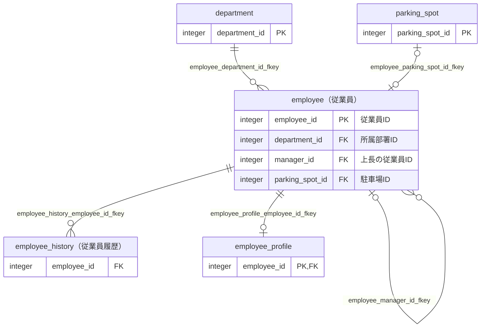
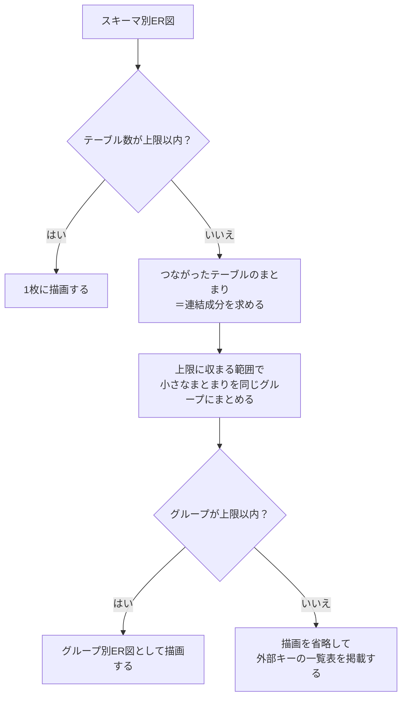
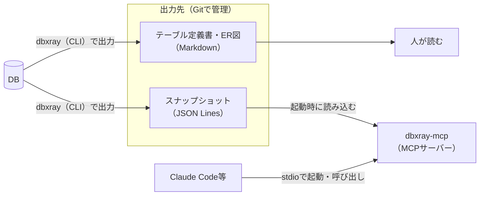

## はじめに

先日、業務であまり詳しくないサブシステムのテーブル構造を理解する必要がありました。

そこで、以前[【PostgreSQL】Markdown形式のテーブル定義書を自動生成するツールを作ってみた](https://qiita.com/ebichan_88/items/bc1ad07b6a7fd1479290)で紹介したツールを改修することにしました。
当時はテーブル定義書しか出力できなかったため、以前から改善を考えていたSQLの修正とあわせて、ER図の出力に対応したのがきっかけです。

その後、開発を進めるうちに欲しい機能が増え、最終的にはテーブル定義書・ER図に加えて、AIにテーブル構造を答えさせるMCPサーバーまで備えたツールになりました。
あわせて、名前もdbxrayに変更しました[^1]。

[^1]: 旧名のexportTableDefinitionはテーブル定義書に特化した名前だったため、より汎用的な名前にしたいと考えていました。当初はGitLensにならって「dblens」とする予定でしたが、同名のリポジトリが既に存在しているようだったため、重複しない名前にしました。

例えば、MCPサーバーを登録したClaude Codeには、次の質問ができます。

- 従業員まわりのテーブルを探して
- 監査ログから部署名を出したいけど、どうJOINすればいい？
- employeeテーブルを変更したら、どこに影響する？
- employeeと構造が似たテーブルはある？

本記事では、dbxrayの概要と、ER図の出力・MCPサーバーの仕組みを紹介します。

## 想定読者

- 巨大なシステムで、テーブル定義書などのドキュメントが整備されていない環境で開発している方
- Claude Code等のAIでコードを書く際に、テーブル構造もAIに参照させたい方

## 前提

:::note info
本記事の内容は、執筆時点の最新版であるv0.4.2に基づいています。
対応DBMSはPostgreSQL 13以上とOracle 12c以上で、動作環境はJava 21です。
なお、配布用のzipにJava実行環境を同梱しているため、Javaのインストールは不要です。
:::

dbxrayは、[ebichan88/dbxray](https://github.com/ebichan88/dbxray)のGitHubリポジトリで公開しています。

本記事の出力例・実行例は、すべてリポジトリに同梱しているサンプルDBから出力したものです。
細かい設定や出力の仕様は、[CLIリファレンス](https://github.com/ebichan88/dbxray/blob/main/docs/usage/cli.md)と[MCPサーバーのドキュメント](https://github.com/ebichan88/dbxray/blob/main/docs/usage/mcp-server.md)をご覧ください。

## 目次 <!-- omit in toc -->

- [dbxrayとは](#dbxrayとは)
- [使い方](#使い方)
  - [入手と実行](#入手と実行)
  - [サイドカーYAMLでDBに無い情報を書き足す](#サイドカーyamlでdbに無い情報を書き足す)
  - [ドキュメントの更新漏れを検知する](#ドキュメントの更新漏れを検知する)
- [ER図の出力について](#er図の出力について)
  - [出力例](#出力例)
  - [出力されるER図の種類](#出力されるer図の種類)
  - [大きなスキーマのER図を分割する](#大きなスキーマのer図を分割する)
  - [多重度の判定](#多重度の判定)
- [MCPサーバーでAIにテーブル構造を答えさせる](#mcpサーバーでaiにテーブル構造を答えさせる)
  - [全体像](#全体像)
  - [設定方法](#設定方法)
  - [AIに質問できること](#aiに質問できること)
  - [構造の似たテーブルを探す仕組み](#構造の似たテーブルを探す仕組み)
  - [ツールの一覧](#ツールの一覧)
  - [MCP Java SDKで作るときの注意点](#mcp-java-sdkで作るときの注意点)
- [開発で苦労したこと](#開発で苦労したこと)
- [おわりに](#おわりに)
- [参考サイト](#参考サイト)

## dbxrayとは

dbxrayは、DBに接続し、テーブル一覧・テーブル定義書・ER図などをMarkdown形式で出力するツールです。
あわせて、出力したデータをAIから検索できるようにするMCPサーバーも同梱しています。

出力物は次の通りです。

| 出力物 | 内容 |
|:---|:---|
| テーブル一覧 | 対象テーブルの一覧と、各テーブル定義書へのリンク |
| テーブル定義書 | カラム・インデックス・制約・外部キー・被参照・トリガーの情報など |
| ER図 | 外部キーの関係を表すMermaid記法の図。テーブル単位とスキーマ単位で出力する |
| 観点ごとのページ | 人事管理などの業務の単位でまとめた、テーブルのER図と一覧 |
| 関数・シーケンス・ユーザー定義型の一覧と個別ページ | 関数・プロシージャの定義本体や、ENUMの値など |
| README | 出力した全ドキュメントへの索引と、スキーマごとのオブジェクト数の集計 |
| スナップショット | 上記と同じ情報を、機械可読なJSON Lines形式にしたもの。MCPサーバーの入力になる |

テーブル定義書には、論理名・物理名・データ型・桁数などを表形式で出力します。
次の表は、サンプルDBの`employee`テーブルのカラム情報の先頭6行です。

| No. | 論理名 | 物理名 | データ型 | 桁数/精度 | PK | Not Null | デフォルト | 備考 |
|:---|:---|:---|:---|:---|:---|:---|:---|:---|
|1|従業員ID|employee_id|integer||○|○|nextval('sample.employee_employee_id_seq'::regclass)||
|2|従業員コード|employee_code|character varying(10)|10||○|||
|3|従業員名|employee_name|character varying(50)|50||○|||
|4|所属部署ID|department_id|integer|||○|||
|5|上長の従業員ID|manager_id|integer||||||
|6|駐車場ID|parking_spot_id|integer||||||

出力サンプルの全体は、[サンプルDBのREADME](https://github.com/ebichan88/dbxray/blob/main/docs/sample/postgres/output/testdb/README.md)から参照できます。

## 使い方

### 入手と実行

[Releases](https://github.com/ebichan88/dbxray/releases/latest)から、OSに合ったzipをダウンロードして展開します。

展開後、`conf/config.yml`に接続先DBの情報を記載します。

```yaml:conf/config.yml（抜粋）
database:
  driver: org.postgresql.Driver
  url: jdbc:postgresql://localhost:5432/testdb
  username: postgres
```

:::note warn
パスワードは`conf/config.yml`ではなく、環境変数`DBXRAY_DB_PASSWORD`で渡します。
AIエージェント等から読まれる可能性のある設定ファイルに、パスワードを残さないためです。
`database.password`を記載したり、接続URLにパスワードを埋め込んだりした場合は、設定の誤りとして扱います。
:::

```bash:実行（Linux／macOS）
export DBXRAY_DB_PASSWORD='パスワード'
./run.sh
```

Windowsの場合は、コマンドプロンプトで`set DBXRAY_DB_PASSWORD=パスワード`を実行した後、`run.bat`を起動します。

処理が完了すると、`output`フォルダ配下に次の構成で出力されます。

```text:出力先の構成（抜粋）
output
├─testdb                          ・・・ Markdownのドキュメント（DBごと）
│  ├─README.md
│  ├─tableList_testdb.md
│  ├─erDiagram_testdb_sample.md
│  ├─viewpoint_testdb_personnel.md
│  └─sample
│     ├─table
│     │  └─employee.md
│     └─function
└─snapshot                        ・・・ スナップショット（MCPサーバーの入力）
   └─testdb
      ├─database.json
      └─sample
         ├─tables.jsonl
         └─functions.jsonl
```

### サイドカーYAMLでDBに無い情報を書き足す

既存のDBでは、外部キー制約が設定されていない、論理名となるコメントが記載されていないなど、DBのメタ情報だけでは分からない情報も多いと思います。

そこで、DBに無い情報を**サイドカーYAML**に記述し、出力にマージできるようにしました。
記述できる情報は次の3種類です。

- `tables`: テーブルの説明・備考と、カラムの備考
- `relations`: 外部キー制約の無いテーブル間の関連である、論理リレーション
- `viewpoints`: 業務の単位でテーブルをまとめる観点

```yaml:annotations.sample.yml（サンプルから抜粋）
tables:
  sample.audit_log:
    description: employeeテーブルの変更を記録する監査ログ。トリガー経由でのみ書き込まれる。

relations:
  - table: sample.audit_log            # 参照元（子）
    columns: [record_id]
    parentTable: sample.employee       # 参照先（親）
    parentColumns: [employee_id]
    cardinality: 0..1対多              # DBに制約が無いので、多重度はここで明示する

viewpoints:
  - id: personnel
    name: 人事管理
    tables:
      - sample.employee*
      - "!sample.employee_directory_view"
      - sample.department
      - sample.parking_spot
```

ER図では、論理リレーションを物理的な外部キーと区別するため、**破線**で描画します。

```text:論理リレーションの描画（スキーマ別ER図から抜粋）
sample_employee |o..o{ sample_audit_log : "record_id"
```

観点を宣言すると、観点ごとのER図と所属テーブルの一覧をまとめたページを出力します。
スキーマ単位のER図は機械的な区切りのため、業務の単位でテーブルを把握したい場合に利用します。

サイドカーYAMLで記述した説明・論理リレーション・観点は、後述するMCPサーバー経由でAIからも参照できます。

### ドキュメントの更新漏れを検知する

`--check`を付けて実行すると、コミット済みのスナップショットと、現在のDBから生成したスナップショットを比較します。
マイグレーション後のドキュメントの再出力漏れを、CIで検知するための機能です。

内容に差分があるオブジェクトは、次のようにunified diff形式で表示します。

```text:--checkの出力例
Content differs:
 - table sample.employee

--- committed/testdb/sample/tables.jsonl (table sample.employee)
+++ generated/testdb/sample/tables.jsonl (table sample.employee)
@@ -8,6 +8,7 @@
   "columns": [
     {"name":"employee_id","type":"integer","primaryKey":true,"notNull":true}
     {"name":"name","type":"character varying(100)","primaryKey":false,"notNull":true}
+    {"name":"nickname","type":"text","primaryKey":false,"notNull":false}
   ]
   "indexes": [
```

差分がある場合は終了コード`1`、比較処理自体が失敗した場合は`2`で終了するため、CIのジョブを失敗させることができます。

比較対象をMarkdownではなくスナップショットにしているのは、実行のたびに変わる値で差分が出ないようにするためです。
スナップショットには、Markdownの先頭に記載している生成日を含めていません[^2]。

[^2]: その代わり、Markdownのみを手作業で編集した場合の差分は検知しません。

## ER図の出力について

本章では、今回の改修のきっかけでもあるER図の出力について紹介します。

### 出力例

ER図は、GitHub等でそのまま図として表示できるMermaid記法で出力します。
次の図は、サンプルDBの観点「人事管理」のページに出力したER図です。



テーブルの箱には、`テーブル名（論理テーブル名）`の見出しと、図中の関連をつなぐカラムのみを表示します。
全カラムを表示すると、箱が大きくなりすぎるためです。
ただし、テーブル定義書内のER図に限り、自テーブルの全カラムを表示します。

### 出力されるER図の種類

ER図は、次の粒度で出力します。

| 出力先 | 内容 |
|:---|:---|
| 各テーブル定義書の「ER図」セクション | 自テーブルと、直接の参照先・参照元のテーブル。描画する段数は1〜3で変更できる |
| スキーマ別ER図 | スキーマ全体のER図 |
| グループ別ER図 | スキーマが大きい場合に、つながったテーブルのまとまりごとに分割したER図 |
| 観点ごとのページ | サイドカーYAMLで宣言した観点の、所属テーブル同士のER図 |

### 大きなスキーマのER図を分割する

前回の記事では、テーブル数が多いとGitHub上でMarkdownがパースされなくなるため、テーブル一覧のファイルを分割していました。
ER図も同様に、大きなスキーマを1枚に描くと線が入り乱れて読みにくくなるため、分割して出力します。

具体的には、1枚に描くテーブル数に上限を設け、上限を超えた場合は次のように出し分けます。
上限の既定値は80で、数える対象は外部キーまたは論理リレーションによる関連を持つテーブルのみです。



小さなまとまりを同じグループにまとめるのは、1テーブルだけのグループが大量に生成されるのを避けるためです。
まとめたテーブル同士は線でつながらないため、関連を誤読するおそれはありません。

また、各テーブル定義書のER図は、上限に収まるまで描画する段数を縮めます。

### 多重度の判定

関連線の多重度は、参照元テーブルの外部キーのカラムに設定された制約から機械的に判定します。
外部キー自体は関連の有無しか示さないため、カラムの一意性とNOT NULL制約をあわせて判定に使います。

| 外部キーのカラムが一意 | すべてNOT NULL | 多重度 | Mermaidの表記 |
|:---|:---|:---|:---|
| × | ○ | 1対多 | `A \|\|--o{ B` |
| × | × | 0..1対多 | `A \|o--o{ B` |
| ○ | ○ | 1対1 | `A \|\|--o\| B` |
| ○ | × | 0..1対1 | `A \|o--o\| B` |

前述のER図では、次のように判定しています。

- `employee.department_id`: NOT NULLで一意ではない → 1対多
- `employee.manager_id`: NULLを許容し一意ではない → 0..1対多
- `employee.parking_spot_id`: UNIQUEでNULLを許容 → 0..1対1
- `employee_profile.employee_id`: 主キーなので一意かつNOT NULL → 1対1

一意性は、カラム名の一致ではなく**包含関係**で判定します。

```sql:一意性を包含関係で判定する例
-- 外部キーは (a, b) の2カラム
ALTER TABLE child ADD FOREIGN KEY (a, b) REFERENCES parent (a, b);
-- a だけで一意なら、(a, b) の組も一意になるため1対1と判定する
ALTER TABLE child ADD UNIQUE (a);
```

逆に、`UNIQUE (a, b)`があっても、外部キーが`(a)`のみであれば1対1にはなりません。

また、一意制約に加えて`CREATE UNIQUE INDEX`で作成した一意索引も判定に使いますが、PostgreSQLの部分インデックスは対象外としています。

```sql:判定から外す部分インデックスの例
-- 削除されていない行の中での一意性しか保証しないため、多重度の判定には使わない
CREATE UNIQUE INDEX ON child (parent_id) WHERE deleted_at IS NULL;
```

## MCPサーバーでAIにテーブル構造を答えさせる

本章では、MCPサーバーについて紹介します。

当初はMCPサーバーを作る予定はありませんでしたが、開発の途中でふと**テーブルの構造をAIが回答できたら面白いのでは**と思い、AIに提案したところ思いのほか話が進みました。
現在は、19個のツールを提供するMCPサーバーになっています。

### 全体像

全体の構成は次の通りです。



ポイントは、**MCPサーバーがDBに接続しない**点です。
dbxrayが出力したスナップショットを読み込むだけなので、AIの実行環境にDBの接続情報を置く必要がなく、テーブルの実データがAIに渡ることもありません。

また、人が読むテーブル定義書とAIが参照する情報は、同じ取得結果から出力しているため、両者に食い違いは生じません。

一方で、DBを変更しても、dbxrayを再実行してスナップショットを更新するまで、変更内容はAIから参照できません[^3]。

[^3]: この鮮度の問題には、前述の`--check`をCIで実行し、スナップショットとDBの乖離を検知することで対応する想定です。

### 設定方法

MCPサーバーの本体は、配布用zipに含まれる`mcp/dbxray-mcp.jar`です。
同梱のJava実行環境で動作するため、Claude Codeの場合は次のコマンドで登録できます。

```bash:Claude Codeへの登録（Linux／macOSの例）
claude mcp add dbxray -- /opt/dbxray-linux/runtime/bin/java -jar /opt/dbxray-linux/mcp/dbxray-mcp.jar --snapshot=/work/schema-docs/output/snapshot
```

`--snapshot`には、dbxrayの出力先の`snapshot`ディレクトリを指定します。

チームで共有する場合は、アプリのリポジトリに`.mcp.json`をコミットし、環境ごとに異なるパスは環境変数で指定します。

```json:.mcp.json
{
  "mcpServers": {
    "dbxray": {
      "command": "${DBXRAY_HOME}/runtime/bin/java",
      "args": ["-jar", "${DBXRAY_HOME}/mcp/dbxray-mcp.jar", "--snapshot=${SCHEMA_SNAPSHOT_DIR}"]
    }
  }
}
```

スナップショットは起動時に読み込むため、`git pull`等で更新した場合は、MCPクライアントからサーバーに再接続してください。

### AIに質問できること

ここでは、サンプルDBに対してツールを実行した結果を交えながら、AIに質問できる内容を紹介します。

#### 業務の言葉でテーブルを探す

テーブル名が英語でも、論理名・説明・カラム名を対象に日本語で検索できます。
次は、`search_tables`で「従業員」を検索した結果です。

```json:search_tables（query: 従業員）の結果（一部抜粋）
{
  "total": 3,
  "tables": [
    {
      "name": "employee",
      "logicalName": "従業員",
      "matchedIn": ["logicalName", "column:employee_id", "column:employee_code", "column:employee_name", "column:manager_id"]
    },
    {
      "name": "employee_history",
      "logicalName": "従業員履歴",
      "matchedIn": ["logicalName"]
    },
    {
      "name": "department",
      "description": "社内の組織単位を管理するマスタテーブル。\n従業員（employee）は必ずいずれか1つの部署に所属する。\n",
      "matchedIn": ["description"]
    }
  ]
}
```

`department`テーブルにはDBのコメントがありませんが、サイドカーYAMLで記述した説明に「従業員」が含まれているため、検索結果に含まれています。
人が補った情報も検索対象になるため、情報を補うほどAIがテーブルを探しやすくなります。

カラム名からテーブルを逆引きすることもできます。


#### JOINの経路を調べる

監査ログの`audit_log`から、変更された従業員の部署名を取得したいケースを考えます。

`audit_log`には外部キー制約がありませんが、サイドカーYAMLで`employee`への論理リレーションを宣言しているため、`find_join_path`でJOINの経路を辿れます。

```json:find_join_path（from: audit_log、to: department）の結果（一部抜粋）
{
  "paths": [
    {
      "tables": ["sample.audit_log", "sample.employee", "sample.department"],
      "joins": [
        {
          "from": "sample.audit_log",
          "fromColumns": ["record_id"],
          "to": "sample.employee",
          "toColumns": ["employee_id"],
          "kind": "logicalRelation",
          "cardinality": "OPTIONAL_ONE_TO_MANY"
        },
        {
          "from": "sample.employee",
          "fromColumns": ["department_id"],
          "to": "sample.department",
          "toColumns": ["department_id"],
          "kind": "foreignKey",
          "cardinality": "ONE_TO_MANY"
        }
      ]
    }
  ]
}
```

結果には、JOINするカラムの組に加えて、外部キーと論理リレーションのどちらによる関連かと、多重度も含まれます。
この結果をもとにSQLを組み立てると、次のようになります。

```sql:返ってきた経路から組み立てたSQLの例
SELECT a.changed_at, a.action, e.employee_name, d.department_name
FROM sample.audit_log a
-- record_idはNULLを許容する0..1対多の関連なので、外部結合にしておく
LEFT JOIN sample.employee e ON e.employee_id = a.record_id
LEFT JOIN sample.department d ON d.department_id = e.department_id;
```

外部キー制約の無いDBでは、AIはカラム名から関連を推測してJOINを書くことになりますが、dbxrayを使えば人が宣言した関連をもとに回答できます。

#### 変更の影響範囲を調べる

`get_impact`を使うと、テーブルを変更・削除した場合の影響範囲を1回の呼び出しで調べられます。
`employee`テーブルの調査結果をまとめると、次の通りです。

| 種類 | 影響を受けるもの |
|:---|:---|
| 外部キーで参照しているテーブル | `attendance`、`employee`の自己参照、`employee_history`、`employee_profile`、`project_assignment` |
| 論理リレーションで参照しているテーブル | `audit_log` |
| 間接的に参照しているテーブル | `attendance_note`。`attendance`を経由する |
| 参照しているビュー | `employee_directory_view`と、それを参照する`attendance_monthly_view` |
| トリガー | `trg_employee_audit`、`trg_employee_set_updated_at` |
| 使っている関数・プロシージャ | `raise_salary`、`close_project`、`department_headcount`など5つ |

関数・プロシージャについては、対象テーブルを登録・参照・更新・削除のどの操作で使っているかを、`operations`にC・R・U・Dで返します。
また、ビューのトリガーから呼び出されて`employee`に登録する関数のように、トリガー経由の利用も`calledByTriggers`で確認できます。

```json:get_impact（table: employee）の結果のうち関数の部分（一部抜粋）
"usages": [
  {
    "function": "sample.raise_salary",
    "kind": "PROCEDURE",
    "overloads": ["IN p_employee_id integer, IN p_amount numeric"],
    "operations": "U"
  },
  {
    "function": "sample.employee_directory_insert",
    "kind": "FUNCTION",
    "overloads": ["()"],
    "operations": "C",
    "calledByTriggers": ["sample.employee_directory_view.trg_employee_directory_insert"]
  }
]
```

関数の利用テーブルは、関数の定義本体から機械的に抽出したもので、`--preview`を付けて実行した場合のみ有効になるプレビュー機能です[^4]。

[^4]: 動的SQLや、呼び出し先の関数内での参照は含みません。こうした取りこぼしの可能性がある関数は、結果の中で別途示します。

#### 構造の似たテーブルを探す

中でも個人的に気に入っているのが、構造の似たテーブルを探す`find_similar_tables`です。
スナップショットのデータをそのまま返すのではなく、類似度の算出などの工夫を加えています。


このとき、MCPサーバーはAIに次のJSONを返しています。

```json:find_similar_tables（table: employee）の結果
{
  "base": "sample.employee",
  "total": 1,
  "tables": [
    {
      "database": "testdb",
      "name": "sample.employee_history",
      "logicalName": "従業員履歴",
      "similarity": 77,
      "kind": "superset",
      "sharedColumns": 11,
      "onlyInOther": ["history_id", "valid_from", "valid_to"],
      "typeMismatches": [
        {
          "column": "employee_name",
          "base": "character varying(50)",
          "other": "character varying(100)",
          "difference": "size"
        }
      ],
      "relatedToBase": true
    }
  ]
}
```

`employee`の11カラムをすべて持ち、`history_id`・`valid_from`・`valid_to`が追加されたテーブルとして、履歴テーブルの`employee_history`を検出しています。
さらに、`employee_name`の桁数のみが本体と異なることも分かります。

新しいテーブルを作る前に同じ目的のテーブルが既に存在しないかを確認したり、履歴・バックアップ用のテーブルを見つけたりする用途を想定しています。

#### ER図を取得する

テーブルの周辺や観点単位のER図を、テーブル定義書と同じ表記のMermaid記法で返します。


### 構造の似たテーブルを探す仕組み

`find_similar_tables`は、カラム名の集合同士を**重み付きJaccard係数**で比較します。
比較の前に、カラム名の大文字小文字・全角半角を統一します。

```math
\text{類似度} = \frac{\sum_{c \in \text{共通のカラム}} w(c)}{\sum_{c \in \text{両者のカラムの和集合}} w(c)}
,\qquad
w(c) = \ln \frac{N + 1}{\text{そのカラム名を持つテーブルの数}}
```

ここで、$N$ はDBのテーブル数です。

重み $w(c)$ は、そのカラム名を持つテーブルが多いほど小さくなります。
これは、`id`や`created_at`のような多くのテーブルに共通する汎用的なカラムを共有しているだけで、類似と判定しないためです。

```java:SimilarTableFinder.java（一部抜粋）
    double weightOf(String name) {
      return Math.log((tables + 1.0) / Math.max(counts.getOrDefault(name, 0), 1));
    }
```

結果には、類似度に加えて次の情報も含めています。

- `kind`: 相手との関係の種類
  - `identical`はカラムが同じ、`superset`は相手が基準の全カラムを持つ、`subset`は相手が基準の一部だけを持つ、`overlap`はそれ以外
- `typeMismatches`: 同名で型が違うカラム
  - 型そのものが違うのか、桁数だけが違うのかも区別する
- `relatedToBase`: 基準と外部キーで直接つながるテーブルかどうか

外部キーでつながるテーブルを除外せず印を付けるのは、履歴テーブルや拡張テーブルが基準のテーブルを参照していることが多いためです。

なお、類似度はカラム名の構造の近さを示すもので、同じ意味のテーブルとは限りません。
同じ目的のテーブルかどうかは、呼び出したAIが`get_table`で説明や定義を確認して判断する役割分担にしています[^5]。

[^5]: DBのテーブル数が少ない場合、汎用的なカラムの重みが十分に下がらないという制約もあります。

### ツールの一覧

v0.4.2時点で、次の19個のツールを提供しています。

| 目的 | ツール | 内容 |
|:---|:---|:---|
| 全体像をつかむ | `list_schemas` | DB・スキーマと、種類ごとのオブジェクトの数 |
| | `list_viewpoints` | 観点の一覧 |
| | `list_table_clusters` | 関連のつながりから推測した、テーブルのまとまり |
| 探す | `search_tables` | キーワードでテーブルを検索する。論理名・説明・カラム名も対象 |
| | `list_tables` | テーブルの一覧と、それぞれの関連の数 |
| | `find_columns` | カラム名から、そのカラムを持つテーブルを逆引きする |
| | `find_similar_tables` | カラム名の構造が似たテーブルを探す |
| 定義を見る | `get_table` | テーブルとビューの定義 |
| 関連をたどる | `get_related_tables` | 外部キー・論理リレーションでつながるテーブル |
| | `find_join_path` | 2つのテーブルをつなぐ最短のJOIN経路 |
| | `get_er_diagram` | Mermaid記法のER図 |
| 影響を調べる | `get_impact` | テーブルを変更・削除したときの影響範囲 |
| その他 | `list_functions`・`get_function`ほか | 関数・シーケンス・ユーザー定義型・トリガーの一覧と定義 |

ツールのほかに、利用者が`@`でテーブルの定義を会話に添付できるリソースも提供しています。
ターミナル版のClaude Codeでは、入力欄に`@受注明細`のように論理名・物理名を入力すると候補が表示されます。

### MCP Java SDKで作るときの注意点

最後に、JavaでMCPサーバーを実装する際の注意点を2つ紹介します。

**標準出力に書き込まない**

dbxrayのMCPサーバーは、MCPクライアントから子プロセスとして起動され、標準入出力で通信します。
この方式では標準出力がMCPのメッセージ専用となるため、`System.out.println`でログを出力すると、メッセージに混入して通信が壊れます。

そのため、利用者向けの表示はすべて標準エラー出力に出し、標準出力へ書き込んでいないことをArchUnitのテストで検査しています。

**ツールの並行呼び出しで応答が止まる**

MCP Java SDKの`mcp-core` 2.0.1は、既定でツールの呼び出しを複数のスレッドで並行に実行します。
しかし、応答の書き込みが同時に発生すると、応答が止まる不具合があります。
MCPクライアントは独立したツールを並行に呼び出すため、通常の利用でも発生します。

この不具合は[java-sdk#686](https://github.com/modelcontextprotocol/java-sdk/issues/686)で報告されています。
dbxrayでは`immediateExecution(true)`を指定し、標準入力を読み込むスレッドで1つずつ実行することで回避しています。

```java:McpServerMain.java（一部抜粋）
    McpServer.sync(new StdioServerTransportProvider(jsonMapper))
        .serverInfo(SERVER_NAME, version())
        .instructions(INSTRUCTIONS)
        .capabilities(ServerCapabilities.builder().tools(false).resources(false, false).build())
        .jsonMapper(jsonMapper)
        .tools(new TableDefinitionTools(catalog).specifications())
        .resources(new TableDefinitionResources(catalog).specifications())
        // 標準入力を読むスレッドで1つずつ実行させて回避する
        .immediateExecution(true)
        .build();
```

ツールの処理はメモリ上の検索のみで高速なため、直列に実行しても実用上の影響は小さいと考えています[^6]。

[^6]: 修正はSDKのmainブランチに取り込まれていますが、執筆時点では未リリースです。修正版がリリースされた時点で、`immediateExecution`の指定を見直す予定です。

## 開発で苦労したこと

今回の改修の大部分はClaude Codeで実装しましたが、最も苦労したのは**AIが作成したソースコードの理解**です。

元々は自分が1から作ったツールのため、ソースコードは熟知していたはずですが、いつの間にか乗っ取られた気分でした。

そこで、可読性・責務分割・命名・例外設計・DDDとしての構成など、様々な観点でリファクタリングを依頼しました。
最終的には、ソースコードの読解ガイドをHTMLで作成させたことで、多少は理解しやすくなりました。

読解ガイドは、事前知識・処理の流れ・ソースごとの役割と関係を図でまとめたもので、GitHub Pagesで公開しています。

- [テーブル定義書等を出力するcliの読解ガイド](https://ebichan88.github.io/dbxray/cli-guide.html)
- [MCPサーバーの読解ガイド](https://ebichan88.github.io/dbxray/mcp-server-guide.html)

## おわりに

今回の改修で特にうれしかったのは、ER図とMCPサーバーの機能を追加できたことです。
どちらも、自分が実際に使いたいと思っていた機能でした。

また、機能強化を進める中で、このツールのコンセプトが**現行システムの読み解き**であると明確に言語化できたと感じています。

巨大なシステムで、テーブル定義書などのドキュメントが整備されていない環境で開発している方には、ぜひお勧めします。
少しでも参考になれば幸いです。

## 参考サイト

- [dbxray](https://github.com/ebichan88/dbxray)
- [Model Context Protocol](https://modelcontextprotocol.io/)
- [MCP Java SDK](https://github.com/modelcontextprotocol/java-sdk)
