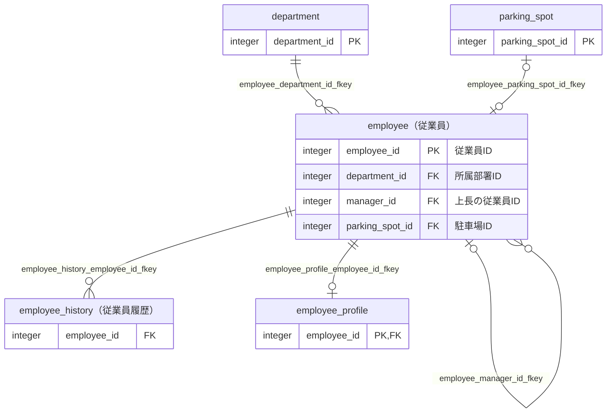
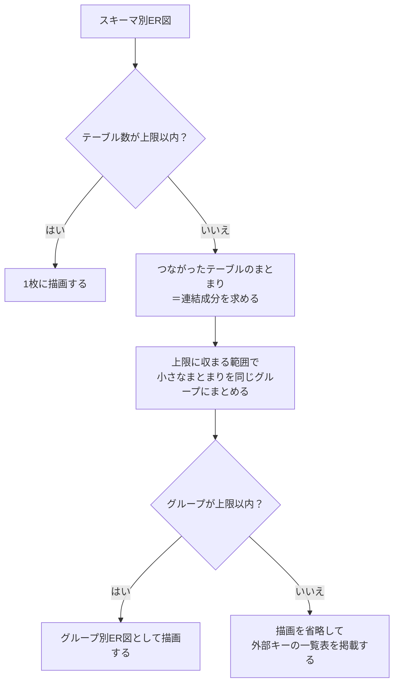
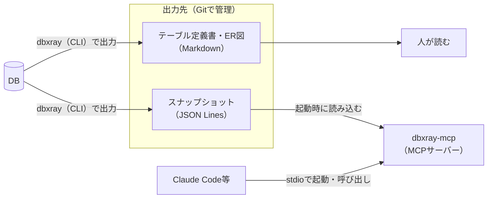

## はじめに

先日、業務で自分があまり詳しくないサブシステムのテーブル構造を理解する必要がありました。

そこで、以前[【PostgreSQL】Markdown形式のテーブル定義書を自動生成するツールを作ってみた](https://qiita.com/ebichan_88/items/bc1ad07b6a7fd1479290)で紹介したツールに手を入れることにしました。
当時はテーブル定義書しか出せなかったので、元々後から改善しようと思っていたSQLの修正とあわせて、ER図を出力できるようにしようと思ったのがきっかけです。

そのあと作りながら、ほしい機能が増えていき・・。
最終的には、テーブル定義書・ER図に加えて、AIにテーブル構造を答えさせるMCPサーバーまで付いたツールになりました。
名前もdbxrayに変えています[^1]。

[^1]: 元の名前のexportTableDefinitionはテーブル定義書に特化した名前だったので、もう少し汎用的な名前にしたいと思っていました。最初はGitLensをイメージして「dblens」にしようと思ったのですが、すでに同じ名前のリポジトリが存在しているようだったので、かぶってなさそうな名前にしました。

例えば、MCPサーバーを登録したClaude Codeには、以下のようなことを聞けます。

- 従業員まわりのテーブルを探して
- 監査ログから部署名を出したいけど、どうJOINすればいい？
- employeeテーブルを変更したら、どこに影響する？
- employeeと構造が似たテーブルはある？

本記事では、dbxrayでできることと、自分が実際に使ってみたいと思って作った**ER図の出力**と**MCPサーバー**の仕組みを紹介します。

## 想定読者

- 巨大なシステムで、テーブル定義書などのドキュメントが整備されていない環境で開発している方
- Claude Code等のAIにコードを書かせるときに、テーブルの構造もAIに調べてもらいたい方

## 前提

:::note info
本記事の内容は、執筆時点で最新のv0.4.2に基づいています。
対応しているDBMSはPostgreSQL 13以上とOracle 12c以上で、Java 21で動きます。
配布用のzipにはJava実行環境を同梱しているので、使うだけならJavaのインストールは不要です。
:::

GitHubのリポジトリは[こちら（dbxray）](https://github.com/ebichan88/dbxray)です。

本記事の出力例・実行例は、すべてリポジトリに同梱しているサンプルのDBから出力したものです。
細かい設定や出力の仕様は、[CLIリファレンス](https://github.com/ebichan88/dbxray/blob/main/docs/usage/cli.md)と[MCPサーバーのドキュメント](https://github.com/ebichan88/dbxray/blob/main/docs/usage/mcp-server.md)をご覧ください。

## 目次 <!-- omit in toc -->

- [dbxrayとは](#dbxrayとは)
- [使い方](#使い方)
  - [入手と実行](#入手と実行)
  - [サイドカーYAMLでDBに無い情報を書き足す](#サイドカーyamlでdbに無い情報を書き足す)
  - [ドキュメントの更新漏れを検知する](#ドキュメントの更新漏れを検知する)
- [ER図の出力について](#er図の出力について)
  - [出力例](#出力例)
  - [出力されるER図の種類](#出力されるer図の種類)
  - [大きなスキーマのER図を分割する](#大きなスキーマのer図を分割する)
  - [多重度の判定](#多重度の判定)
- [MCPサーバーでAIにテーブル構造を答えさせる](#mcpサーバーでaiにテーブル構造を答えさせる)
  - [全体像](#全体像)
  - [設定方法](#設定方法)
  - [AIに聞けること](#aiに聞けること)
  - [構造の似たテーブルを探す仕組み](#構造の似たテーブルを探す仕組み)
  - [ツールの一覧](#ツールの一覧)
  - [MCP Java SDKで作るときの注意点](#mcp-java-sdkで作るときの注意点)
- [開発で苦労したこと](#開発で苦労したこと)
- [おわりに](#おわりに)
- [参考サイト](#参考サイト)

## dbxrayとは

dbxrayは、DBに接続して、テーブル一覧・テーブル定義書・ER図などをMarkdown形式で出力するツールです。
あわせて、出力したデータをAIから検索できるようにするMCPサーバーも同梱しています。

出力されるものは以下のとおりです。

| 出力物 | 内容 |
|:---|:---|
| テーブル一覧 | 対象のテーブルの一覧と、各テーブル定義書へのリンク |
| テーブル定義書 | カラム・インデックス・制約・外部キー・被参照・トリガーの情報など |
| ER図 | 外部キーの関係を表すMermaid記法の図。テーブル単位とスキーマ単位で出力する |
| 観点ごとのページ | 人事管理などの業務の単位でまとめた、テーブルのER図と一覧 |
| 関数・シーケンス・ユーザー定義型の一覧と個別ページ | 関数・プロシージャの定義本体や、ENUMの値など |
| README | 出力した全ドキュメントへの索引と、スキーマごとのオブジェクトの数の集計 |
| スナップショット | 上記と同じ情報を、機械可読なJSON Lines形式にしたもの。MCPサーバーはこれを読む |

テーブル定義書は、論理名・物理名・データ型・桁数などを並べた形で出力します。
以下は、サンプルのDBの`employee`テーブルのカラム情報の先頭6行です。

| No. | 論理名 | 物理名 | データ型 | 桁数/精度 | PK | Not Null | デフォルト | 備考 |
|:---|:---|:---|:---|:---|:---|:---|:---|:---|
|1|従業員ID|employee_id|integer||○|○|nextval('sample.employee_employee_id_seq'::regclass)||
|2|従業員コード|employee_code|character varying(10)|10||○|||
|3|従業員名|employee_name|character varying(50)|50||○|||
|4|所属部署ID|department_id|integer|||○|||
|5|上長の従業員ID|manager_id|integer||||||
|6|駐車場ID|parking_spot_id|integer||||||

出力のサンプル全体は、[サンプルのDBのREADME](https://github.com/ebichan88/dbxray/blob/main/docs/sample/postgres/output/testdb/README.md)から辿れます。

## 使い方

### 入手と実行

[Releases](https://github.com/ebichan88/dbxray/releases/latest)から、OSに合ったzipをダウンロードして展開します。

展開したら、`conf/config.yml`に接続先のDBの情報を書きます。

```yaml:conf/config.yml（抜粋）
database:
  driver: org.postgresql.Driver
  url: jdbc:postgresql://localhost:5432/testdb
  username: postgres
```

パスワードは`conf/config.yml`には書けないようにしていて、環境変数`DBXRAY_DB_PASSWORD`で渡します[^2]。

[^2]: AIエージェント等から読まれうる設定ファイルに、パスワードを残さないためです。`database.password`を書いたり、接続URLにパスワードを埋め込んだりすると、誤りとして扱います。

```bash:実行（Linux／macOS）
export DBXRAY_DB_PASSWORD='パスワード'
./run.sh
```

Windowsの場合は、コマンドプロンプトで`set DBXRAY_DB_PASSWORD=パスワード`を実行してから`run.bat`を実行します。

処理が終わると、`output`フォルダ配下に以下のような形で出力されます。

```text:出力先の構成（抜粋）
output
├─testdb                          ・・・ Markdownのドキュメント（DBごと）
│  ├─README.md
│  ├─tableList_testdb.md
│  ├─erDiagram_testdb_sample.md
│  ├─viewpoint_testdb_personnel.md
│  └─sample
│     ├─table
│     │  └─employee.md
│     └─function
└─snapshot                        ・・・ スナップショット（MCPサーバーの入力）
   └─testdb
      ├─database.json
      └─sample
         ├─tables.jsonl
         └─functions.jsonl
```

### サイドカーYAMLでDBに無い情報を書き足す

現行のDBだと、外部キー制約が張られていなかったり、論理名となるコメントが書かれていなかったりと、DBのメタ情報だけでは分からないことも多いかと思います。

そこで、DBに無い情報は**サイドカーYAML**というファイルに書いて、出力にマージできるようにしています。
書けるのは以下の3種類です。

- `tables`: テーブルの説明・備考と、カラムの備考
- `relations`: 外部キー制約の無いテーブル間の関連を、論理リレーションとして宣言する
- `viewpoints`: 業務の単位でテーブルをまとめる観点

```yaml:annotations.sample.yml（サンプルから抜粋）
tables:
  sample.audit_log:
    description: employeeテーブルの変更を記録する監査ログ。トリガー経由でのみ書き込まれる。

relations:
  - table: sample.audit_log            # 参照元（子）
    columns: [record_id]
    parentTable: sample.employee       # 参照先（親）
    parentColumns: [employee_id]
    cardinality: 0..1対多              # DBに制約が無いので、多重度はここで明示する

viewpoints:
  - id: personnel
    name: 人事管理
    tables:
      - sample.employee*
      - "!sample.employee_directory_view"
      - sample.department
      - sample.parking_spot
```

論理リレーションは、ER図では物理的な外部キーと区別できるように**破線**で描画します。

```text:論理リレーションの描画（スキーマ別ER図から抜粋）
sample_employee |o..o{ sample_audit_log : "record_id"
```

観点を宣言すると、観点ごとにER図と所属テーブルの一覧をまとめたページが出力されます。
スキーマ単位のER図は機械的なまとまりなので、人が読む単位でまとめたいときに使います。

ここで書き足した説明・論理リレーション・観点は、後述するMCPサーバーからAIも引けるようになります。

### ドキュメントの更新漏れを検知する

`--check`を付けて実行すると、コミット済みのスナップショットと、DBの現状のスナップショットを比較します。
マイグレーションの後にドキュメントを出力し直し忘れていないかを、CIで検知するための機能です。

内容が違うオブジェクトは、以下のようにunified diffの形式で表示します。

```text:--checkの出力例
Content differs:
 - table sample.employee

--- committed/testdb/sample/tables.jsonl (table sample.employee)
+++ generated/testdb/sample/tables.jsonl (table sample.employee)
@@ -8,6 +8,7 @@
   "columns": [
     {"name":"employee_id","type":"integer","primaryKey":true,"notNull":true}
     {"name":"name","type":"character varying(100)","primaryKey":false,"notNull":true}
+    {"name":"nickname","type":"text","primaryKey":false,"notNull":false}
   ]
   "indexes": [
```

差分がある場合は終了コード`1`、比較そのものに失敗した場合は`2`で終了するので、CIのジョブをそのまま失敗させられます。

Markdownではなくスナップショットを比較しているのは、スナップショットには生成日を含めていないためです。
Markdownの先頭に載せている生成日のように、実行するたびに変わる値で差分にならないようにしています[^3]。

[^3]: その代わり、Markdownだけを手作業で編集した、といった差分は検知しません。

## ER図の出力について

ここからは、今回の改修のきっかけの1つでもある、ER図の出力について紹介します。

### 出力例

ER図は、GitHubなどでそのまま図として表示できるMermaid記法で出力します。
以下は、サンプルのDBの観点「人事管理」のページに出力されたER図です。



テーブルの箱には、`テーブル名（論理テーブル名）`の見出しと、図に描いた関連をつなぐカラムだけを表示しています。
全カラムを表示すると、箱が大きくなりすぎるためです。
ただし、テーブル定義書の中のER図だけは、自テーブルの全カラムを表示します。

### 出力されるER図の種類

ER図は、以下の粒度で出力します。

| 出力先 | 内容 |
|:---|:---|
| 各テーブル定義書の「ER図」セクション | 自テーブルと、直接の参照先・参照元のテーブル。描く段数は1〜3で変更できる |
| スキーマ別ER図 | スキーマ全体のER図 |
| グループ別ER図 | スキーマが大きい場合に、つながったテーブルのまとまりごとに分割したER図 |
| 観点ごとのページ | サイドカーYAMLで宣言した観点の、所属テーブル同士のER図 |

### 大きなスキーマのER図を分割する

前回の記事では、テーブル数が多いとGitHub上でMarkdownがパースされなくなるため、テーブル一覧のファイルを分割する対応をしていました。
ER図も、大きなスキーマを1枚に描くと線が入り乱れて読みにくくなるため、分割して出力するようにしています。

具体的には、1枚に描くテーブルの数に上限を設けていて、既定は80です。
なお、ここで数えるのは、外部キーまたは論理リレーションによる関連を持つテーブルだけです。
上限を超えた場合は、以下のように出し分けています。



小さなまとまりを同じグループにまとめているのは、1テーブルだけのグループが大量にできるのを避けるためです。
まとめたテーブル同士は線でつながっていないので、関連を誤読するおそれもありません。

また、各テーブル定義書のER図は、描く段数を上限に収まるところまで縮めて描画します。

### 多重度の判定

関連線の多重度は、参照元のテーブルの外部キーのカラムに付いた制約から機械的に判定しています。
外部キーそのものは関連があることしか示さないので、カラムが一意かどうかと、NOT NULLかどうかを合わせて見ています。

| 外部キーのカラムが一意 | すべてNOT NULL | 多重度 | Mermaidの表記 |
|:---|:---|:---|:---|
| × | ○ | 1対多 | `A \|\|--o{ B` |
| × | × | 0..1対多 | `A \|o--o{ B` |
| ○ | ○ | 1対1 | `A \|\|--o\| B` |
| ○ | × | 0..1対1 | `A \|o--o\| B` |

上のER図の例だと、以下のように判定されています。

- `employee.department_id`: NOT NULLで一意ではない → 1対多
- `employee.manager_id`: NULLを許容し一意ではない → 0..1対多
- `employee.parking_spot_id`: UNIQUEでNULLを許容 → 0..1対1
- `employee_profile.employee_id`: 主キーなので一意かつNOT NULL → 1対1

一意かどうかは、カラム名の一致ではなく**包含関係**で判定しています。

```sql:一意性を包含関係で判定する例
-- 外部キーは (a, b) の2カラム
ALTER TABLE child ADD FOREIGN KEY (a, b) REFERENCES parent (a, b);
-- a だけで一意なら、(a, b) の組も一意になるため1対1と判定する
ALTER TABLE child ADD UNIQUE (a);
```

逆に、`UNIQUE (a, b)`があっても外部キーが`(a)`だけなら1対1にはなりません。

また、一意制約だけでなく`CREATE UNIQUE INDEX`で作った一意索引も判定に使いますが、PostgreSQLの部分インデックスは対象から外しています。

```sql:判定から外す部分インデックスの例
-- 削除されていない行の中での一意性しか保証しないため、多重度の判定には使わない
CREATE UNIQUE INDEX ON child (parent_id) WHERE deleted_at IS NULL;
```

## MCPサーバーでAIにテーブル構造を答えさせる

続いて、MCPサーバーについて紹介します。

もともとMCPサーバーを作る予定は無かったのですが、作っている途中でふと**テーブルの構造をAIが回答できたら面白いのでは**と思い、AIに提案してみたところ思いのほか話が進みました。
今では、19個のツールを持つMCPサーバーになっています。

### 全体像

全体の構成は以下のとおりです。



ポイントは、**MCPサーバーはDBに接続しない**ことです。
dbxrayが出力したスナップショットのファイルを読むだけなので、AIの実行環境にDBの接続情報を置く必要がなく、テーブルの中の実データがAIに渡ることもありません。

また、人が読むテーブル定義書と、AIが引く情報は同じ取得結果から出力しているので、両者が食い違うこともありません。

その代わり、DBを変更しても、dbxrayを実行し直してスナップショットを更新するまではAIからは見えません[^4]。

[^4]: この鮮度の問題は、前述の`--check`をCIで回して、スナップショットとDBの乖離を検知する想定です。

### 設定方法

MCPサーバーの本体は、配布用zipの`mcp/dbxray-mcp.jar`です。
同梱のJava実行環境で動くので、Claude Codeであれば以下のコマンドで登録できます。

```bash:Claude Codeへの登録（Linux／macOSの例）
claude mcp add dbxray -- /opt/dbxray-linux/runtime/bin/java -jar /opt/dbxray-linux/mcp/dbxray-mcp.jar --snapshot=/work/schema-docs/output/snapshot
```

`--snapshot`には、dbxrayの出力先の`snapshot`ディレクトリを指定します。

チームで共有する場合は、アプリのリポジトリに`.mcp.json`をコミットして、各自の環境で異なるパスは環境変数で与える形にしています。

```json:.mcp.json
{
  "mcpServers": {
    "dbxray": {
      "command": "${DBXRAY_HOME}/runtime/bin/java",
      "args": ["-jar", "${DBXRAY_HOME}/mcp/dbxray-mcp.jar", "--snapshot=${SCHEMA_SNAPSHOT_DIR}"]
    }
  }
}
```

スナップショットは起動時に読み込むので、`git pull`等で更新した場合は、MCPクライアントからサーバーに再接続します。

### AIに聞けること

ここからは、サンプルのDBに対して実際にツールを呼び出した結果を交えながら、AIに何を聞けるかを紹介します。

#### 業務の言葉でテーブルを探す

テーブル名が英語でも、論理名・説明・カラム名から日本語で探せます。
以下は、`search_tables`で従業員と検索した結果です。

```json:search_tables（query: 従業員）の結果（一部抜粋）
{
  "total": 3,
  "tables": [
    {
      "name": "employee",
      "logicalName": "従業員",
      "matchedIn": ["logicalName", "column:employee_id", "column:employee_code", "column:employee_name", "column:manager_id"]
    },
    {
      "name": "employee_history",
      "logicalName": "従業員履歴",
      "matchedIn": ["logicalName"]
    },
    {
      "name": "department",
      "description": "社内の組織単位を管理するマスタテーブル。\n従業員（employee）は必ずいずれか1つの部署に所属する。\n",
      "matchedIn": ["description"]
    }
  ]
}
```

`department`テーブルはDBにコメントが無いのですが、サイドカーYAMLで書き足した説明に従業員という言葉が入っていたので、ヒットしています。
人が書き足した情報まで検索の対象になるので、書き足すほどAIが探しやすくなります。

カラム名からテーブルを逆引きすることもできます。


#### JOINの経路を調べる

監査ログの`audit_log`から、変更された従業員の部署名を出したい、という場面を考えます。

`audit_log`には外部キー制約が無いのですが、サイドカーYAMLで`employee`への論理リレーションを宣言しているので、`find_join_path`で経路をたどれます。

```json:find_join_path（from: audit_log、to: department）の結果（一部抜粋）
{
  "paths": [
    {
      "tables": ["sample.audit_log", "sample.employee", "sample.department"],
      "joins": [
        {
          "from": "sample.audit_log",
          "fromColumns": ["record_id"],
          "to": "sample.employee",
          "toColumns": ["employee_id"],
          "kind": "logicalRelation",
          "cardinality": "OPTIONAL_ONE_TO_MANY"
        },
        {
          "from": "sample.employee",
          "fromColumns": ["department_id"],
          "to": "sample.department",
          "toColumns": ["department_id"],
          "kind": "foreignKey",
          "cardinality": "ONE_TO_MANY"
        }
      ]
    }
  ]
}
```

どのカラム同士でJOINするかに加えて、外部キーか論理リレーションかと、多重度も返します。
この結果をそのままSQLにすると、以下のようになります。

```sql:返ってきた経路から組み立てたSQLの例
SELECT a.changed_at, a.action, e.employee_name, d.department_name
FROM sample.audit_log a
-- record_idはNULLを許容する0..1対多の関連なので、外部結合にしておく
LEFT JOIN sample.employee e ON e.employee_id = a.record_id
LEFT JOIN sample.department d ON d.department_id = e.department_id;
```

外部キー制約の無いDBだと、AIはカラム名から関連を推測してJOINを書くことになりますが、人が宣言した関連をもとに答えられるのがポイントです。

#### 変更の影響範囲を調べる

`get_impact`を使うと、テーブルを変更・削除したときの影響範囲を1回で調べられます。
`employee`テーブルで調べた結果をまとめると、以下のとおりです。

| 種類 | 影響を受けるもの |
|:---|:---|
| 外部キーで参照しているテーブル | `attendance`、`employee`の自己参照、`employee_history`、`employee_profile`、`project_assignment` |
| 論理リレーションで参照しているテーブル | `audit_log` |
| 間接的に参照しているテーブル | `attendance_note`。`attendance`を経由する |
| 参照しているビュー | `employee_directory_view`と、それを参照する`attendance_monthly_view` |
| トリガー | `trg_employee_audit`、`trg_employee_set_updated_at` |
| 使っている関数・プロシージャ | `raise_salary`、`close_project`、`department_headcount`など5つ |

関数・プロシージャについては、このテーブルを登録・参照・更新・削除のどれで使っているかを、`operations`にC・R・U・Dで返します。
ビューのトリガーから呼ばれて`employee`に登録する関数のように、トリガー経由で使われていることも`calledByTriggers`で分かります。

```json:get_impact（table: employee）の結果のうち関数の部分（一部抜粋）
"usages": [
  {
    "function": "sample.raise_salary",
    "kind": "PROCEDURE",
    "overloads": ["IN p_employee_id integer, IN p_amount numeric"],
    "operations": "U"
  },
  {
    "function": "sample.employee_directory_insert",
    "kind": "FUNCTION",
    "overloads": ["()"],
    "operations": "C",
    "calledByTriggers": ["sample.employee_directory_view.trg_employee_directory_insert"]
  }
]
```

この関数の部分は、関数の定義本体から利用しているテーブルを機械的に抜き出したもので、`--preview`を付けて実行したときだけ動くプレビューの機能です[^5]。

[^5]: 動的SQLの中や、呼び出している別の関数の中の参照は含まれません。そういった取りこぼしの可能性がある関数は、結果の中で別に示すようにしています。

#### 構造の似たテーブルを探す

個人的に気に入っているのが、構造の似たテーブルを探す`find_similar_tables`です。


ただ単にスナップショットのデータを返すのではなく、工夫しているところがいいなと思っています。

このとき、MCPサーバーからAIには以下のJSONが返っています。

```json:find_similar_tables（table: employee）の結果
{
  "base": "sample.employee",
  "total": 1,
  "tables": [
    {
      "database": "testdb",
      "name": "sample.employee_history",
      "logicalName": "従業員履歴",
      "similarity": 77,
      "kind": "superset",
      "sharedColumns": 11,
      "onlyInOther": ["history_id", "valid_from", "valid_to"],
      "typeMismatches": [
        {
          "column": "employee_name",
          "base": "character varying(50)",
          "other": "character varying(100)",
          "difference": "size"
        }
      ],
      "relatedToBase": true
    }
  ]
}
```

`employee`の11カラムをすべて持ったうえで、`history_id`・`valid_from`・`valid_to`が追加されているテーブルとして、履歴テーブルの`employee_history`が見つかっています。
さらに、`employee_name`の桁数だけが本体とずれていることまで分かります。

新しいテーブルを作る前に同じ目的のテーブルがすでに無いかを確かめたり、履歴・バックアップ用のテーブルを見つけたりする用途を想定しています。

#### ER図を描かせる

テーブルの周辺や観点のER図を、定義書と同じ表記のMermaidで返します。


### 構造の似たテーブルを探す仕組み

`find_similar_tables`は、カラム名の集合同士を**重み付きのJaccard係数**で比べています。
カラム名は、大文字小文字・全角半角を揃えてから比べます。

```math
\text{類似度} = \frac{\sum_{c \in \text{共通のカラム}} w(c)}{\sum_{c \in \text{両者のカラムの和集合}} w(c)}
,\qquad
w(c) = \ln \frac{N + 1}{\text{そのカラム名を持つテーブルの数}}
```

$N$ はDBのテーブルの数です。

重み $w(c)$ は、そのカラム名を持つテーブルが多いほど小さくなります。
`id`や`created_at`のように多くのテーブルが持つ汎用的なカラムを共有しているだけで、似ていると判定しないためです。

```java:SimilarTableFinder.java（一部抜粋）
    double weightOf(String name) {
      return Math.log((tables + 1.0) / Math.max(counts.getOrDefault(name, 0), 1));
    }
```

結果には、類似度に加えて以下のような情報も付けています。

- `kind`: 相手との関係の種類
  - `identical`はカラムが同じ、`superset`は相手が基準の全カラムを持つ、`subset`は相手が基準の一部だけを持つ、`overlap`はそれ以外
- `typeMismatches`: 同名で型が違うカラム
  - 型そのものが違うのか、桁数だけが違うのかも区別する
- `relatedToBase`: 基準と外部キーで直接つながるテーブルかどうか

外部キーでつながるテーブルを除外せずに印を付けているのは、履歴テーブルや拡張テーブルは基準のテーブルを参照していることが多いためです。

あくまでカラム名の構造が似ているだけで、同じ意味のテーブルとは限りません。
同じ目的のテーブルかどうかは、呼び出したAIが`get_table`で説明や定義を見て判断する、という役割分担にしています[^6]。

[^6]: DBのテーブル数が少ない場合は、汎用的なカラムの重みが十分に下がらない、という限界もあります。

### ツールの一覧

v0.4.2の時点で、以下の19個のツールを用意しています。

| 目的 | ツール | 内容 |
|:---|:---|:---|
| 全体像をつかむ | `list_schemas` | DB・スキーマと、種類ごとのオブジェクトの数 |
| | `list_viewpoints` | 観点の一覧 |
| | `list_table_clusters` | 関連のつながりから推測した、テーブルのまとまり |
| 探す | `search_tables` | キーワードでテーブルを検索する。論理名・説明・カラム名も対象 |
| | `list_tables` | テーブルの一覧と、それぞれの関連の数 |
| | `find_columns` | カラム名から、そのカラムを持つテーブルを逆引きする |
| | `find_similar_tables` | カラム名の構造が似たテーブルを探す |
| 定義を見る | `get_table` | テーブルとビューの定義 |
| 関連をたどる | `get_related_tables` | 外部キー・論理リレーションでつながるテーブル |
| | `find_join_path` | 2つのテーブルをつなぐ最短のJOIN経路 |
| | `get_er_diagram` | Mermaid記法のER図 |
| 影響を調べる | `get_impact` | テーブルを変更・削除したときの影響範囲 |
| その他 | `list_functions`・`get_function`ほか | 関数・シーケンス・ユーザー定義型・トリガーの一覧と定義 |

ツールのほかに、利用者が`@`でテーブルの定義を会話に添付できるリソースも用意しています。
ターミナル版のClaude Codeであれば、入力欄に`@受注明細`のように論理名・物理名を打つと候補が出てきます。

### MCP Java SDKで作るときの注意点

最後に、JavaでMCPサーバーを作るときに気をつけたことを2つ紹介します。

**標準出力に書き込まない**

dbxrayのMCPサーバーは、MCPクライアントから子プロセスとして起動され、標準入出力で通信します。
この場合、標準出力はMCPのメッセージ専用なので、うっかり`System.out.println`でログを出すとメッセージに混ざって通信が壊れてしまいます。

そのため、利用者向けの表示はすべて標準エラーに出し、標準出力へ書き込んでいないことをArchUnitのテストで検査しています。

**ツールの並行呼び出しで応答が止まる**

MCPのJava SDKの`mcp-core` 2.0.1は、既定ではツールの呼び出しを複数のスレッドで並行に実行します。
ところが、応答の書き込みが同時に起きると応答が止まってしまう不具合があります。
MCPクライアントは独立したツールを並行に呼ぶので、普通に使っていても起こります。

この不具合は[java-sdk#686](https://github.com/modelcontextprotocol/java-sdk/issues/686)で報告されていて、dbxrayでは`immediateExecution(true)`を指定し、標準入力を読むスレッドで1つずつ実行させて回避しています。

```java:McpServerMain.java（一部抜粋）
    McpServer.sync(new StdioServerTransportProvider(jsonMapper))
        .serverInfo(SERVER_NAME, version())
        .instructions(INSTRUCTIONS)
        .capabilities(ServerCapabilities.builder().tools(false).resources(false, false).build())
        .jsonMapper(jsonMapper)
        .tools(new TableDefinitionTools(catalog).specifications())
        .resources(new TableDefinitionResources(catalog).specifications())
        // 標準入力を読むスレッドで1つずつ実行させて回避する
        .immediateExecution(true)
        .build();
```

ツールの処理はメモリ上の検索だけで速いので、直列に実行しても実用上の影響は小さいと考え、この形にしています[^7]。

[^7]: 修正はSDKのmainブランチには入っていますが、執筆時点ではまだリリースされていません。修正が入った版がリリースされたら、`immediateExecution`を残すかを見直す想定です。

## 開発で苦労したこと

今回の改修のほとんどはClaude Codeに実装してもらったのですが、一番苦労したのは**AIが作ったソースの理解**です。

もともと自分が1から作っていたツールなので、ソースには詳しかったはずですが、いつの間にか乗っ取られた気分でした・・。

そこで、可読性・責務分割・命名・例外設計・DDDとしての構成など、様々な観点でリファクタリングをお願いしました。
最終的には、ソースの読解ガイドをHTMLで作らせたことで、多少は改善しました。

読解ガイドは、事前知識・処理の流れ・ソースごとの役割と繋がりを図でまとめたもので、GitHub Pagesで公開しています。

- [テーブル定義書等を出力するcliの読解ガイド](https://ebichan88.github.io/dbxray/cli-guide.html)
- [MCPサーバーの読解ガイド](https://ebichan88.github.io/dbxray/mcp-server-guide.html)

## おわりに

うれしかったことといえば、ER図やMCPサーバーの機能が付いたことです。
どちらも、自分が実際に使ってみたいと思った機能なので。

また、機能強化を進めながら、自分が作りたかったツールのコンセプトが**現行システムの読み解き**だと、明確に言語化された気がします。

巨大なシステムで、テーブル定義書などのドキュメントが整備されていない環境で開発している方には、ぜひお勧めしたいです。
少しでも参考になれば幸いです。

## 参考サイト

- [dbxray](https://github.com/ebichan88/dbxray)
- [Model Context Protocol](https://modelcontextprotocol.io/)
- [MCP Java SDK](https://github.com/modelcontextprotocol/java-sdk)
